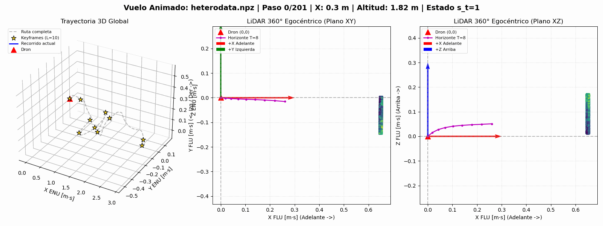
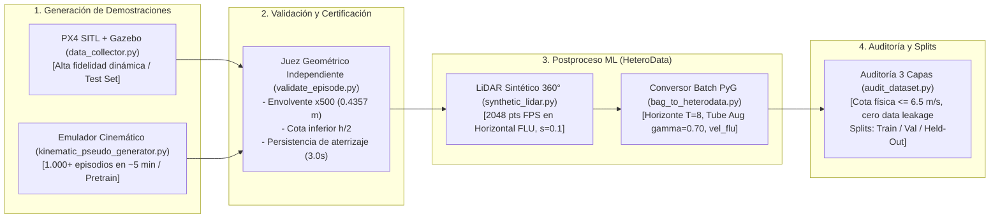
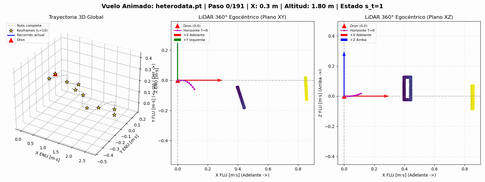
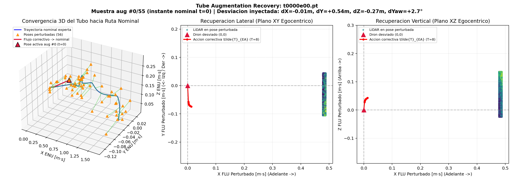
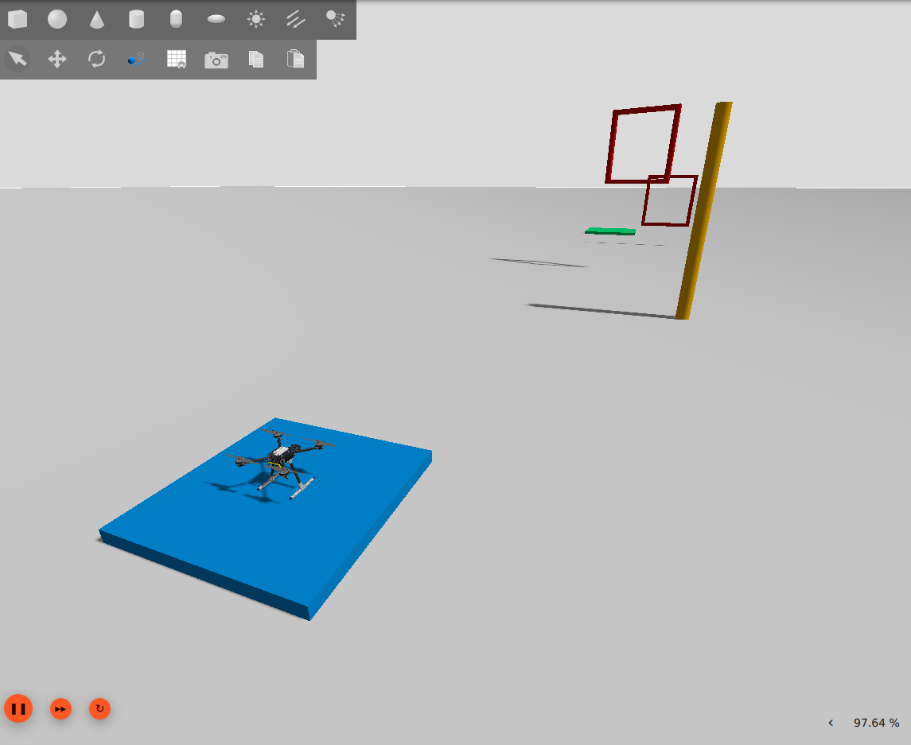
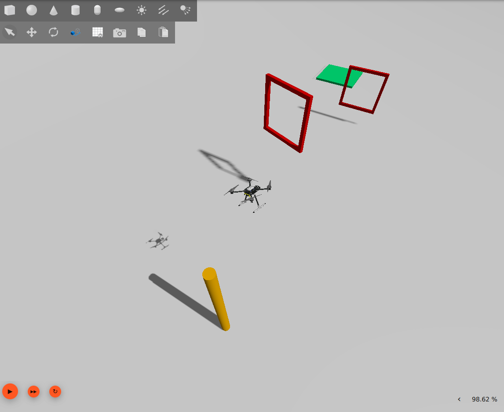
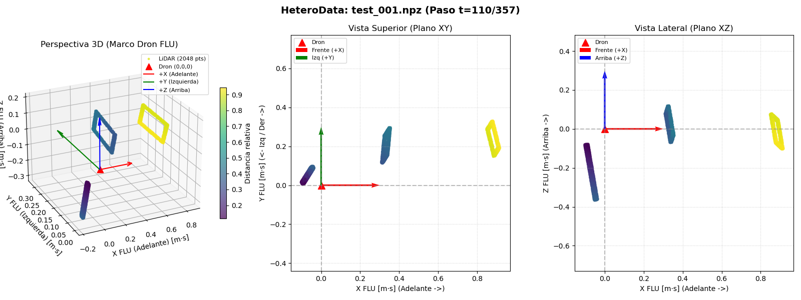

# UAV Instant Policy: Data Collection & Synthetic LiDAR Pipeline

*Pipeline de recolección de demostraciones, simulación física de alta fidelidad, generación cinemática masiva y preparación de grafos heterogéneos para In-Context Imitation Learning (ICIL) en cuadricópteros autónomos.*

---

## 📖 Descripción del Proyecto

Este proyecto implementa la infraestructura completa de generación, validación física y procesamiento de datos para entrenar un modelo de **Aprendizaje por Imitación en Contexto (*In-Context Imitation Learning* - ICIL)** basado en la arquitectura **Instant Policy** (Vosylius y Johns, ICLR 2025) adaptada a vehículos aéreos no tripulados (UAV).

El sistema utiliza **ROS 2 Jazzy**, **Gazebo Harmonic** y **PX4 Autopilot SITL** para simular cuadricópteros tipo x500 que navegan procedimentalmente circuitos 3D de obstáculos (*landmarks*: puertas cuadradas, aros circulares, postes y plataformas de aterrizaje), complementado con un generador cinemático ultrarrápido para pre-entrenamiento masivo en escala.

<p align="center">
   
   <br>
   <em>Figura 1: Visualización sincronizada del vuelo en 3D (izquierda), proyección egocéntrica del LiDAR 360° en plano horizontal XY (centro) y perfil vertical en plano XZ (derecha) mostrando la maniobra de sobrepaso. Escala en X reducida (ENU).</em>
</p>



---

## 🗂️ Estructura del Espacio de Trabajo

```text
ros2_ws/
├── pyproject.toml                 # Configuración canónica de pytest y pythonpath
├── src/
│   ├── px4_msgs/                  # Definiciones de mensajes DDS de PX4 (VehicleOdometry, etc.)
│   ├── px4_offboard/              # Ejemplos base y nodos de apoyo para modo Offboard
│   └── uav_ip/
│       ├── package.xml
│       ├── setup.py
│       ├── scripts/               # Scripts ejecutables y herramientas CLI
│       │   ├── data_collector.py             # Orquestador de recolección SITL (PX4 + Gazebo)
│       │   ├── kinematic_pseudo_generator.py # Generador cinemático ultrarrápido (50 Hz, PyG)
│       │   ├── bag_to_heterodata.py          # Conversor por lotes a HeteroData (.pt) con Tube Aug
│       │   ├── audit_dataset.py              # Auditoría en 3 capas y particionado Train/Val/Held-Out
│       │   ├── task_generator.py             # Generador de configuraciones semánticas (v1 / v2)
│       │   ├── world_generator.py            # Generador procedural de mundos SDF y waypoints.yaml
│       │   ├── validate_episode.py           # CLI del validador físico de episodios
│       │   ├── synthetic_lidar.py            # CLI de prueba para nubes de puntos 360°
│       │   ├── visualize_dataset.py          # CLI de visualización 3D y análisis de recuperación
│       │   ├── setup_venv_ip.sh              # Aprovisionamiento del entorno virtual ML (~/venv_ip)
│       │   ├── kill_sim.sh                   # Limpieza agresiva de procesos huérfanos de simulación
│       │   └── test_flight.sh                # Lanzador rápido de un vuelo de prueba aislado
│       ├── uav_ip/                # Biblioteca central de lógica de negocio (Punto Único de Verdad)
│       │   ├── base_pilot.py          # Ciclo de vida ROS 2 y protocolo de armado Offboard seguro
│       │   ├── waypoint_controller.py # Piloto experto (feed-forward, cruce tangencial, orbit cw/ccw)
│       │   ├── tracking_controller.py # Prototipo experimental de control continuo por seguimiento
│       │   ├── validation_geometry.py # Geometría compartida, envolvente x500 (0.3857m) y obstáculos
│       │   ├── validate_episode.py    # Motor de validación física, reloj, MCAP/CRC32 y misiones
│       │   ├── synthetic_lidar.py     # Generador analítico LiDAR 360° (Horizontal FLU, kernel C SIMD)
│       │   └── visualize_dataset.py   # Motor de renderizado 3D y animaciones GIF
│       └── test/                  # Suite completa de pruebas unitarias e integradas (63 tests)
├── docs/                          # Documentación técnica canónica consolidada
│   ├── assets/                    # Animaciones GIF y capturas de simulación
│   ├── FUNDAMENTOS_Y_DISENO.md           # Teoría matemática, ADRs, envolventes y catálogo v2
│   ├── AUDITORIA_CONSISTENCIA_Y_LITERATURA.md # Auditoría forense y bibliografía anotada
│   ├── PLAN_IMPLEMENTACION.md            # Hoja de ruta activa e hitos del proyecto
│   └── TROUBLESHOOTING.md                # Solución de problemas comunes en WSL2, ROS y PX4
└── datasets/                      # Almacenamiento local de datasets y particiones
```

---

## ⚙️ Prerrequisitos y Configuración del Entorno

### 1. Requisitos del Sistema
- **Sistema Operativo:** Ubuntu 24.04 LTS (nativo o bajo WSL2 en Windows 11).
- **Simulador:** PX4 Autopilot (`make px4_sitl gz_x500`).
- **Middleware:** ROS 2 Jazzy con agente de transporte `MicroXRCEAgent` (`udp4 -p 8888`).

### 2. Entorno de Simulación ROS 2 (Python del Sistema)
En la terminal donde vayas a compilar o lanzar vuelos de simulación:
```bash
source /opt/ros/jazzy/setup.bash
colcon build --packages-select uav_ip --symlink-install
source install/setup.bash
export ROS_DOMAIN_ID=33
export ROS_AUTOMATIC_DISCOVERY_RANGE=LOCALHOST
```

### 3. Entorno de Machine Learning (`~/venv_ip`)
Para proteger el entorno de ROS 2 de conflictos de librerías bajo la política PEP 668 de Ubuntu 24.04, las dependencias pesadas de PyTorch y PyTorch Geometric residen en un virtualenv aislado:
```bash
# Provisionar el entorno virtual (ejecutar una sola vez):
bash src/uav_ip/scripts/setup_venv_ip.sh

# El entorno queda listo en ~/venv_ip (también accesible como ../venv_ip desde ros2_ws)
```

---

## 🛠️ Manual de Referencia de Scripts (Guía Operativa Detallada)

A continuación se detalla el propósito, parámetros y modo de uso de cada script del proyecto:

---

### 1. `data_collector.py` — Orquestador de Recolección SITL

* **Para qué sirve:**
  Automatiza la recolección masiva de vuelos en el simulador físico. Para cada tarea y episodio: lanza `MicroXRCEAgent`, arranca PX4 SITL con Gazebo Harmonic (`gz_x500`), graba el rosbag en formato MCAP, ejecuta el piloto experto autónomo (`waypoint_controller`), valida el vuelo post-cierre y, si el episodio es rechazado, lanza reintentos limpios con semilla derivada (`episode_XX_attempt_YY`) sin sobrescribir el intento original.

* **Parámetros Principales (con alias unificados):**
  * `--num-tasks`: Número de tareas procedurales únicas a generar (default: 2).
  * `--episodes-per-task`: Episodios con variación espacial intra-tarea por cada tarea (default: 15).
  * `--catalog-version {v1, v2}`: Versión del catálogo de acciones (`v1`: 5 acciones base; `v2`: 9 acciones con desacople objeto-acción y giros horarios/antihorarios).
  * `--seed` (alias: `--base-seed`): Semilla aleatoria base (default: 0).
  * `--output-dir` (alias: `--dataset-dir`): Directorio raíz de salida (default: `datasets`).
  * `--max-retries`: Máximo de reintentos permitidos ante episodios rechazados (default: 2).
  * `--resume`: Reanudar una campaña interrumpida desde el último episodio incompleto.

* **Ejemplo de Ejecución:**
  ```bash
  python3 src/uav_ip/scripts/data_collector.py \
    --num-tasks 10 \
    --episodes-per-task 5 \
    --catalog-version v2 \
    --seed 42 \
    --output-dir datasets_sitl_v2
  ```

* **Qué esperar y cómo verificar:**
  * En consola observará el ciclo de arranque, vuelo y validación de cada episodio.
  * Al finalizar, el script imprime un resumen consolidado con las tasas de aceptación de intentos primarios y post-reintentos.
  * Cada carpeta `datasets_sitl_v2/task_XXXX/episode_YY` contendrá:
    * `rosbag/`: Bolsa MCAP con telemetría de odometría, comandos y reloj.
    * `waypoints.yaml`: Poses geométricas de los obstáculos y plataforma.
    * `validation_report.json`: Dictamen exhaustivo del juez físico (`validation_status: "accepted"`).
    * `episode_meta.json`: Metadatos del vuelo y tiempos de ejecución.

---

### 2. `kinematic_pseudo_generator.py` — Generador Cinemático Masivo Ultrarrápido

* **Para qué sirve:**
  Genera pseudo-demostraciones cinemáticas continuas a $50\text{ Hz}$ en Python puro, calculando la actitud analítica mediante dinámica diferencial plana ($\mathbf{a} - \mathbf{g}$) y perfil de aceleración trapezoidal. Cada episodio es evaluado en memoria por el mismo validador físico (`validate_episode_data()`) y exportado directamente a grafos `HeteroData` (.pt). Permite generar miles de episodios en minutos para pre-entrenamiento masivo en escala (*scaling laws*), excluyendo las firmas del dataset físico para garantizar cero fuga de datos (*zero data leakage*).

<p align="center">
   
   <br>
   <em>Figura 2: Demostración cinemática continua generada a 50 Hz en Python puro con dinámica diferencial y actitud analítica, 100% conforme con el validador físico para pre-entrenamiento masivo.</em>
</p>

* **Parámetros Principales:**
  * `--num-tasks`: Cantidad de tareas únicas a sintetizar (default: 100).
  * `--episodes-per-task`: Episodios por tarea (default: 5).
  * `--catalog-version {v1, v2}`: Versión del catálogo combinatorio (default: `v2`).
  * `--exclude-signatures-from` (alias: `--exclude-tasks-from`): Uno o más directorios de datasets físicos (o archivos JSON) cuyas firmas semánticas deben excluirse estrictamente.
  * `--output-dir`: Directorio donde guardar el dataset cinemático (default: `datasets_kinematic`).
  * `--workers` (`-j`): Procesos paralelos a utilizar (default: todos los núcleos CPU).
  * `--tube-decay`: Factor $\gamma$ de convergencia exponencial en Tube Augmentation (default: 0.70).
  * `--require-torch`: Exigir exportación en formato PyTorch Geometric `.pt` (requiere `venv_ip`).

* **Ejemplo de Ejecución:**
  ```bash
  ~/venv_ip/bin/python3 src/uav_ip/scripts/kinematic_pseudo_generator.py \
    --num-tasks 200 \
    --episodes-per-task 5 \
    --catalog-version v2 \
    --exclude-signatures-from datasets_sitl_v2 \
    --output-dir datasets_kinematic \
    --workers 8 \
    --require-torch
  ```

* **Qué esperar y cómo verificar:**
  * Genera $1.000$ episodios ($200 \times 5$) en aproximadamente **5 a 8 minutos**.
  * Tasa de aceptación del **100%**: el script reintenta internamente variando la semilla geométrica hasta que cada episodio satisface todas las restricciones físicas del validador.
  * Cada carpeta contendrá directamente `heterodata.pt`, `task_config.yaml`, `waypoints.yaml` y `validation_report.json`.

---

### 3. `bag_to_heterodata.py` — Conversor Batch a Grafos HeteroData

* **Para qué sirve:**
  Procesa los rosbags MCAP de los vuelos físicos de simulación para construir grafos heterogéneos `torch_geometric.data.HeteroData` (.pt). Remuestrea la telemetría a una grilla uniforme de $10\text{ Hz}$ con SLERP de cuaterniones, calcula el horizonte de acciones relativas futuras $T_{EA} \in SE(3)$ a horizonte $T=8$, computa las observaciones LiDAR 360° analíticas en marco *Horizontal FLU*, calcula el vector de velocidad propioceptiva `vel_flu` $(T, 3)$, y genera los nodos de recuperación por *Tube Augmentation* ($30\%$ de pasos con decaimiento exponencial $\gamma = 0.70$).

<p align="center">
   
   <br>
   <em>Figura 3: Recuperación activa mediante Tube Augmentation: poses perturbadas fuera del eje nominal y vectores de acción correctiva reconvergentes hacia el centro de los obstáculos con decaimiento exponencial $\gamma = 0.70$ y cota física $\le 6.5\text{ m/s}$.</em>
</p>

* **Parámetros Principales:**
  * `--dataset-dir`: Directorio raíz del dataset con carpetas `task_XXXX` para procesamiento por lotes.
  * `--require-torch`: Abortar con error si PyTorch no está disponible, evitando caídas silenciosas a `.npz`.
  * `--tube-decay`: Factor de decaimiento geométrico por paso en Tube Augmentation (default: 0.70).
  * `--overwrite`: Sobrescribir archivos `heterodata` previamente generados.
  * `--skip-existing`: Omitir episodios que ya tengan su archivo `heterodata.pt`.
  * `--workers` (`-j`): Número de procesos paralelos para acelerar la conversión (default: todos los núcleos).
  * `--scale`: Factor de escala métrica $s$ aplicado a posiciones y nubes (default: 0.1).

* **Ejemplo de Ejecución:**
  ```bash
  ~/venv_ip/bin/python3 src/uav_ip/scripts/bag_to_heterodata.py \
    --dataset-dir datasets_sitl_v2 \
    --require-torch \
    --tube-decay 0.70 \
    --workers 8 \
    --overwrite
  ```

* **Qué esperar y estructura del grafo resultante:**
  * Cada episodio aceptado tendrá su archivo `heterodata.pt`.
  * Estructura de tensores en `HeteroData`:
    * `data['scene'].pos`: $(T, 2048, 3)$ nube de puntos egocéntrica en Horizontal FLU (escala $s=0.1$).
    * `data['agent'].x` / `pos_enu`: $(T, 3)$ posiciones escaladas.
    * `data['agent'].pose_se3`: $(T, 4, 4)$ matriz homogénea $T_{WE}^t \in SE(3)$.
    * `data['agent'].vel_flu`: $(T, 3)$ velocidad lineal en Horizontal FLU a $10\text{ Hz}$.
    * `data['agent'].y` / `action_se3`: $(T, 8, 5)$ y $(T, 8, 4, 4)$ horizonte de $T=8$ acciones relativas futuras.
    * `data['agent'].valid_mask`: $(T, 8)$ máscara booleana de horizonte temporal válido.
    * `data['aug']`: nodos de perturbación de recuperación por Tube Augmentation.

---

### 4. `audit_dataset.py` — Auditoría en 3 Capas y Particionado Oficial

* **Para qué sirve:**
  Ejecuta una auditoría estricta en tres capas sobre un dataset existente y genera las particiones oficiales disjuntas `train`, `val` y `held_out`:
  * **Capa 1 (Vuelos Brutos):** Verifica conteo de episodios, tasas de éxito primario vs. reintentos y distribución de motivos de rechazo.
  * **Capa 2 (Tensores ML):** Inspecciona cada archivo `.pt`, verificando finitud de valores, dimensiones exactas, ortogonalidad en $SO(3)$ y comprobando que ninguna acción de recuperación de Tube Augmentation supere la velocidad física admisible ($\le 6.5\text{ m/s}$).
  * **Capa 3 (Partición Formal):** Filtra tareas con al menos $N$ episodios aceptados y baraja deterministamente las firmas semánticas para garantizar que ninguna tarea de `held_out` comparta firma con `train` (cero fuga de datos).

* **Parámetros Principales:**
  * `--dataset-dir`: Directorio del dataset a auditar.
  * `--require-pt`: Exige formato PyTorch Geometric `.pt` (rechaza archivos `.npz` como inválidos).
  * `--min-accepted-episodes`: Mínimo de episodios aceptados por tarea para entrar a los splits (default: 5).
  * `--seed`: Semilla determinista para barajar las firmas (default: 42).
  * `--train-ratio` / `--val-ratio` / `--held-out-ratio`: Proporciones de partición (default: 0.70 / 0.15 / 0.15).
  * `--no-export`: Modo solo lectura en terminal sin escribir archivos JSON.

* **Ejemplo de Ejecución:**
  ```bash
  ~/venv_ip/bin/python3 src/uav_ip/scripts/audit_dataset.py \
    --dataset-dir datasets_sitl_v2 \
    --require-pt
  ```

* **Qué esperar:**
  * Si el dataset cumple todas las restricciones, concluye con:
    `🎉 OVERALL AUDIT STATUS: PASS (0 errors)`
  * Genera en `datasets_sitl_v2/splits/`:
    * `train_tasks.json`, `val_tasks.json`, `held_out_tasks.json`.
    * `dataset_summary.json`: Reporte estadístico completo auditable.

---

### 5. `task_generator.py` — Generador Semántico de Tareas

* **Para qué sirve:**
  Define la receta semántica única de una tarea (`task_config.yaml`) sin reemplazo a partir de un catálogo combinatorio balanceado de $N \in [2, 5]$ landmarks.

* **Parámetros Principales:**
  * `--task-id`: Identificador de la tarea (ej. `task_0001`).
  * `--catalog-version {v1, v2}`: Catálogo combinatorio (`v1`: 5 acciones base; `v2`: 9 acciones expandidas).
  * `--seed`: Semilla pseudoaleatoria de generación.
  * `--output-dir`: Directorio donde escribir `task_config.yaml`.
  * `--include-circular-gates`: Habilitar aros circulares además de puertas cuadradas.

* **Ejemplo de Ejecución:**
  ```bash
  python3 src/uav_ip/scripts/task_generator.py \
    --task-id task_0001 \
    --catalog-version v2 \
    --seed 42 \
    --output-dir /tmp/test_task
  cat /tmp/test_task/task_config.yaml
  ```

---

### 6. `world_generator.py` — Generador de Mundos SDF y Waypoints

* **Para qué sirve:**
  Toma la receta semántica de `task_config.yaml` e instancia poses aleatorias 3D para cada obstáculo a lo largo del pasillo en $+X$, garantizando separaciones mínimas, alineación de la plataforma de aterrizaje y verificando la factibilidad geométrica de transiciones (`check_circuit_transition_feasibility`). Genera el archivo de mundo Gazebo `.sdf` y el archivo de navegación `waypoints.yaml`.

<p align="center">
   
   <br>
   <em>Figura 4: Entorno de simulación física en Gazebo Harmonic con landmarks procedurales (aros cuadrados, toroides circulares, postes cilíndricos y plataforma de aterrizaje).</em>
</p>

* **Modo de Uso:**
  Es invocado automáticamente por `data_collector.py` y `kinematic_pseudo_generator.py`. Para inspección manual:
  ```bash
  python3 src/uav_ip/scripts/world_generator.py \
    --task-config /tmp/test_task/task_config.yaml \
    --seed 101 \
    --output-sdf /tmp/test_task/world.sdf \
    --output-waypoints /tmp/test_task/waypoints.yaml
  ```

---

### 7. `validate_episode.py` — CLI del Validador Físico de Episodios

* **Para qué sirve:**
  Permite validar de forma independiente y reproducible un episodio individual o un dataset completo a partir de sus archivos `.mcap` y `waypoints.yaml`.

* **Contrato de Códigos de Retorno en Terminal:**
  * Código `0`: Todos los episodios evaluados fueron aceptados (`validation_status == "accepted"`).
  * Código `1`: Al menos un episodio fue rechazado por motivos físicos, de misión o de grabación.
  * Código `2`: Error de sintaxis, argumentos inválidos o rutas inexistentes.

* **Ejemplo de Ejecución:**
  ```bash
  # Validar un episodio individual:
  python3 src/uav_ip/scripts/validate_episode.py \
    --episode-dir datasets_sitl_v2/task_0000/episode_00 \
    --strict

  # Validar un dataset completo y exportar reporte JSON:
  python3 src/uav_ip/scripts/validate_episode.py \
    --dataset-dir datasets_sitl_v2 \
    --json > /tmp/reporte_validacion.json
  ```

---

### 8. `visualize_dataset.py` — Visualizador 3D y Análisis Gráfico

* **Para qué sirve:**
  Proporciona herramientas visuales interactivas en Matplotlib para inspeccionar las trayectorias de vuelo en 3D, proyecciones en planos horizontal (XY) y vertical (XZ), animaciones GIF y análisis gráfico de los vectores de recuperación de Tube Augmentation.

<p align="center">
   
   
   <br>
   <em>Figura 5: Correspondencia 1-a-1 entre el entorno físico simulado en Gazebo (izquierda) y la observación LiDAR sintética 360° egocéntrica en marco Horizontal FLU (derecha).</em>
</p>

* **Ejemplo de Ejecución:**
  ```bash
  # Inspección estática 3D de un episodio:
  python3 src/uav_ip/scripts/visualize_dataset.py \
    --bag-path datasets_sitl_v2/task_0000/episode_00

  # Inspección de los vectores de recuperación de Tube Augmentation:
  python3 src/uav_ip/scripts/visualize_dataset.py \
    --bag-path datasets_sitl_v2/task_0000/episode_00 \
    --show-aug

  # Generar una animación GIF interactiva del vuelo:
  python3 src/uav_ip/scripts/visualize_dataset.py \
    --bag-path datasets_sitl_v2/task_0000/episode_00 \
    --animate --save-gif /tmp/vuelo_animado.gif
  ```

---

### 9. Scripts de Apoyo y Mantenimiento

* **`kill_sim.sh`:**
  Mata de forma agresiva y limpia todos los procesos huérfanos o zombies de Gazebo (`gz sim`), PX4 SITL, MicroXRCEAgent y nodos ROS 2 que hayan quedado en segundo plano tras una interrupción con `Ctrl+C`:
  ```bash
  bash src/uav_ip/scripts/kill_sim.sh
  ```

* **`setup_venv_ip.sh`:**
  Aprovisiona el entorno virtual aislado `~/venv_ip` instalando PyTorch, PyG y sus dependencias compatibles con el sistema:
  ```bash
  bash src/uav_ip/scripts/setup_venv_ip.sh
  ```

* **`test_flight.sh`:**
  Lanza un vuelo de prueba rápido de un solo episodio en el simulador para verificar visualmente que Gazebo, PX4 y el piloto experto funcionen correctamente:
  ```bash
  bash src/uav_ip/scripts/test_flight.sh
  ```

---

## 🚀 Flujos de Trabajo Recomendados (Workflows Paso a Paso)

### Workflow A: Pre-entrenamiento Masivo Rápido (Corpus Cinemático)
*Objetivo: Generar 1.000 demostraciones en ~5 minutos para entrenar la red de difusión.*

1. Generar el dataset cinemático con catálogo $v2$:
   ```bash
   ~/venv_ip/bin/python3 src/uav_ip/scripts/kinematic_pseudo_generator.py \
     --num-tasks 200 \
     --episodes-per-task 5 \
     --catalog-version v2 \
     --output-dir datasets_kinematic \
     --workers 8 \
     --require-torch
   ```
2. Auditar el dataset y generar splits oficiales:
   ```bash
   ~/venv_ip/bin/python3 src/uav_ip/scripts/audit_dataset.py \
     --dataset-dir datasets_kinematic \
     --require-pt
   ```

---

### Workflow B: Campaña Física en Simulación SITL (Dataset de Evaluación / Fine-Tuning)
*Objetivo: Generar demostraciones físicas de alta fidelidad en PX4 + Gazebo.*

1. Preparar la terminal de simulación:
   ```bash
   source /opt/ros/jazzy/setup.bash
   source install/setup.bash
   export ROS_DOMAIN_ID=33
   export ROS_AUTOMATIC_DISCOVERY_RANGE=LOCALHOST
   ```
2. Ejecutar la campaña física con catálogo $v2$:
   ```bash
   python3 src/uav_ip/scripts/data_collector.py \
     --num-tasks 12 \
     --episodes-per-task 5 \
     --catalog-version v2 \
     --seed 42 \
     --output-dir datasets_sitl_v2
   ```
3. Convertir los rosbags a grafos `HeteroData` (.pt):
   ```bash
   ~/venv_ip/bin/python3 src/uav_ip/scripts/bag_to_heterodata.py \
     --dataset-dir datasets_sitl_v2 \
     --require-torch \
     --tube-decay 0.70 \
     --workers 8 \
     --overwrite
   ```
4. Auditar y generar splits de evaluación formal:
   ```bash
   ~/venv_ip/bin/python3 src/uav_ip/scripts/audit_dataset.py \
     --dataset-dir datasets_sitl_v2 \
     --require-pt
   ```

---

## 🧪 Verificación de Tests Automatizados (`pytest`)

El paquete incluye una suite completa de pruebas unitarias que verifica la geometría, el LiDAR analítico, las transformaciones $SE(3)$, el decaimiento de Tube Augmentation y el generador cinemático:

```bash
pytest src/uav_ip/test -q
```
*Resultado esperado:* **`63 passed in ~11s`** (con 0 fallos y 0 tests omitidos).

---

## 📚 Documentación Técnica Canónica

Para profundizar en los fundamentos matemáticos y la memoria técnica del proyecto:
* **[Fundamentos Teóricos, Decisiones de Diseño y Memoria Arquitectónica](docs/FUNDAMENTOS_Y_DISENO.md):** Formalización matemática de Instant Policy, preservación de Markov, envolvente real del x500, catálogo $v2$ y registro histórico de decisiones (ADRs).
* **[Auditoría de Consistencia, Ejecución Forense y Literatura Relacionada](docs/AUDITORIA_CONSISTENCIA_Y_LITERATURA.md):** Informe técnico de revisión cruzada, análisis forense de anomalías y bibliografía científica anotada.
* **[Plan Maestro de Implementación](docs/PLAN_IMPLEMENTACION.md):** Hoja de ruta activa, componentes completados y arquitectura de la red neuronal (Hito 4).
* **[Guía de Troubleshooting](docs/TROUBLESHOOTING.md):** Resolución rápida de errores de PX4, Gazebo, FastDDS y virtualenvs.