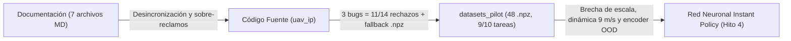

# Auditoría Exhaustiva de Consistencia, Ejecución Forense y Literatura Relacionada — *UAV Instant Policy*

*Informe técnico de revisión cruzada · Octubre de 2026*

> [!NOTE]
> Este documento consolida y desarrolla en profundidad los hallazgos de la auditoría cruzada realizada sobre el repositorio `uav_ip` ([`README.md`](file:///home/gabrielq/ros2_ws/README.md)), sus datasets generados (`datasets_pilot/` y `datasets_legacy_v1/`), el artículo original **Instant Policy** (Vosylius & Johns, ICLR 2025) y la literatura científica reciente sobre *In-Context Imitation Learning* (ICIL), aumentación guiada por tubos y navegación aprendida en cuadricópteros. Incluye al final (Sección 4) una **bibliografía anotada con enlaces directos y guía de lectura** orientada a fundamentar el trabajo final de la especialización.

---

## Resumen y Veredicto Ejecutivo

* **Nivel de logro en ingeniería de captura y validación (ROS 2 Jazzy + PX4 SITL + Gazebo Harmonic):** **~80% (Alto).**
  El pipeline resuelve problemas reales y no triviales de robótica aérea en simulación bajo WSL2: generación procedural de mundos SDF sin solapamiento, control *offboard* estable en PX4, grabación ligera en MCAP ($< 5\text{ MB}$ por vuelo), verificación de integridad binaria CRC32, desambiguación analítica de saltos de reloj XRCE-DDS mediante `/fmu/out/timesync_status`, interpolación uniforme a $10\text{ Hz}$ con SLERP/desenvolvimiento de fase, y preservación auditable de intentos fallidos.
* **Nivel de logro hacia el objetivo de aprendizaje (Dataset confiable y alineado para entrenar una red tipo *Instant Policy* en drones):** **~60% – 65% (Intermedio; requiere ajustes puntuales de alto retorno antes de entrenar la red neuronal).**
  Aunque las transformaciones geométricas estáticas entre marcos (`NED/FRD` $\leftrightarrow$ `ENU` $\leftrightarrow$ `Horizontal FLU`) están bien implementadas, existen **cuatro brechas verificadas** que afectan directamente al entrenamiento de la red neuronal:
  1. **Sesgo de selección inducido por 3 bugs internos:** El **78.6% (11 de 14)** de los episodios rechazados en `datasets_pilot` no fallaron por inestabilidad física de PX4, sino por tres defectos deterministas en [`validate_episode.py`](file:///home/gabrielq/ros2_ws/src/uav_ip/uav_ip/validate_episode.py) y [`waypoint_controller.py`](file:///home/gabrielq/ros2_ws/src/uav_ip/uav_ip/waypoint_controller.py). Esto eliminó por completo a `task_0003` (la única tarea con dos órbitas consecutivas, `orbit -> orbit`) de las particiones de entrenamiento y evaluación.
  2. ** Incompatibilidad dinámica en las etiquetas de *Tube Augmentation* y ausencia de velocidad en el estado:** Apuntar a la pose nominal $T_{WE}^{t+1}$ en un solo paso ($\Delta t = 0.1\text{ s}$) desde perturbaciones de hasta $0.60\text{ m}$ genera etiquetas con velocidades implícitas de hasta **$9.09\text{ m/s}$** (casi el doble de la velocidad máxima del experto), violando la factibilidad dinámica de un cuadricóptero y el régimen de pequeños desplazamientos ($\sim 1\text{ cm} / 3^\circ$) del álgebra de Lie $\mathfrak{se}(3)$ en *Instant Policy*. Además, se descarta la velocidad lineal del dron al exportar el grafo.
  3. **Ejecución del post-procesamiento fuera de `../venv_ip`:** Aunque el entorno virtual aislado con PyTorch y PyTorch Geometric **sí existe** un nivel por encima del repositorio (`/home/gabrielq/venv_ip`, creado mediante [`setup_venv_ip.sh`](file:///home/gabrielq/ros2_ws/src/uav_ip/scripts/setup_venv_ip.sh)), la conversión por lotes de `datasets_pilot` fue invocada con el Python del sistema (`/usr/bin/python3`), activando silenciosamente el *fallback* a archivos NumPy comprimidos (`heterodata.npz`) sin estructura de aristas `HeteroData` (`.pt`), sin que [`audit_dataset.py`](file:///home/gabrielq/ros2_ws/src/uav_ip/scripts/audit_dataset.py) emitiera advertencia alguna.
  4. **Brecha de diversidad de tareas frente a la arquitectura de ~100M de parámetros:** *Instant Policy* adquiere su capacidad *in-context* pre-entrenando sobre **~700,000 pseudo-demostraciones cinemáticas** (generadas sin simulador físico) antes de ajustar con datos reales/simulados. Entrenar un *Heterogeneous Graph Transformer* grande únicamente con 6 tareas (`datasets_pilot`) o incluso 40 tareas de SITL lleva a memorizar firmas discretas en lugar de inferir tareas nuevas desde el contexto.



---

## Parte 1: Revisión Cruzada en Tres Ejes

### 1.1. Eje Documentación $\leftrightarrow$ Código $\leftrightarrow$ Entorno de Ejecución

El repositorio acumula actualmente siete documentos activos ([`README.md`](file:///home/gabrielq/ros2_ws/README.md), [`AGENT.md`](file:///home/gabrielq/ros2_ws/AGENT.md), [`MEMORY.md`](file:///home/gabrielq/ros2_ws/MEMORY.md), [`ESTRATEGIA_TEORICA.md`](file:///home/gabrielq/ros2_ws/docs/ESTRATEGIA_TEORICA.md), [`DECISIONES_DISENO.md`](file:///home/gabrielq/ros2_ws/docs/DECISIONES_DISENO.md), [`JUSTIFICACION_REVISION_TECNICA.md`](file:///home/gabrielq/ros2_ws/docs/JUSTIFICACION_REVISION_TECNICA.md), [`PLAN_IMPLEMENTACION.md`](file:///home/gabrielq/ros2_ws/docs/PLAN_IMPLEMENTACION.md) y [`TROUBLESHOOTING.md`](file:///home/gabrielq/ros2_ws/docs/TROUBLESHOOTING.md)) que repiten las mismas definiciones con distinto grado de actualización. La revisión cruzada contra el código real arroja **ocho discrepancias concretas**:

| # | Aspecto Auditado | Declaración en Documentación | Realidad en Código y Dataset |
| :- | :--- | :--- | :--- |
| **1** | **Estado de la Fase 3 (Piloto $10 \times 5$)** | [`PLAN_IMPLEMENTACION.md`](file:///home/gabrielq/ros2_ws/docs/PLAN_IMPLEMENTACION.md#L265-L270) la marca como `[x] COMPLETADO` (48/50 slots aceptados). En cambio, [`MEMORY.md`](file:///home/gabrielq/ros2_ws/MEMORY.md#L30-L36) y [`JUSTIFICACION_REVISION_TECNICA.md`](file:///home/gabrielq/ros2_ws/docs/JUSTIFICACION_REVISION_TECNICA.md#L253) la mantienen como `[PENDIENTE]`. | `datasets_pilot/` ya fue ejecutado y auditado el 25–26 de octubre de 2026; `MEMORY.md` y `JUSTIFICACION_REVISION_TECNICA.md` quedaron desactualizados. |
| **2** | **Política ante saltos de reloj XRCE-DDS (Patrón B)** | [`README.md`](file:///home/gabrielq/ros2_ws/README.md#L281-L282), [`TROUBLESHOOTING.md`](file:///home/gabrielq/ros2_ws/docs/TROUBLESHOOTING.md#L79-L80) y [`JUSTIFICACION_REVISION_TECNICA.md`](file:///home/gabrielq/ros2_ws/docs/JUSTIFICACION_REVISION_TECNICA.md#L176) indican que el Patrón B se repara con `/fmu/out/timesync_status`. Pero [`DECISIONES_DISENO.md`](file:///home/gabrielq/ros2_ws/docs/DECISIONES_DISENO.md#L392) sigue afirmando que el Patrón B se rechaza siempre sin reparar. | [`validate_episode.py`](file:///home/gabrielq/ros2_ws/src/uav_ip/uav_ip/validate_episode.py#L1308-L1328) sí repara saltos correlacionados con `TimesyncStatus.estimated_offset` ($\pm 0.05\text{ s}$). Los 2 rechazos por Patrón B en `datasets_pilot` fueron caídas reales de entrega ($2.782\text{ s}$ y $0.215\text{ s}$) no atribuibles a recalibración de offset. |
| **3** | **Uso de `../venv_ip` y formato real en `datasets_pilot`** | [`README.md`](file:///home/gabrielq/ros2_ws/README.md#L298-L326) y [`PLAN_IMPLEMENTACION.md`](file:///home/gabrielq/ros2_ws/docs/PLAN_IMPLEMENTACION.md#L185-L189) documentan que el modo batch produce tensores `HeteroData` `.pt` usando el entorno aislado `~/venv_ip` (`../venv_ip`). | El entorno `/home/gabrielq/venv_ip` existe un nivel arriba del workspace, pero `datasets_pilot` contiene **48 archivos `heterodata.npz` y 0 archivos `.pt`**. Esto ocurrió porque [`bag_to_heterodata.py`](file:///home/gabrielq/ros2_ws/src/uav_ip/scripts/bag_to_heterodata.py#L1558-L1595) fue corrido sin activar `../venv_ip` y degradó silenciosamente a NumPy, mientras [`audit_dataset.py`](file:///home/gabrielq/ros2_ws/src/uav_ip/scripts/audit_dataset.py) dio `48/48 válidos` sin distinguir `.npz` de `.pt`. |
| **4** | **Tamaño del espacio combinatorio de tareas** | [`ESTRATEGIA_TEORICA.md`](file:///home/gabrielq/ros2_ws/docs/ESTRATEGIA_TEORICA.md#L137-L148) declara $5^3 = 125$ tareas para $N=3$ y $3,900$ para $N \in [2, 5]$. Sin embargo, [`DECISIONES_DISENO.md`](file:///home/gabrielq/ros2_ws/docs/DECISIONES_DISENO.md#L146-L155) y [`MEMORY.md`](file:///home/gabrielq/ros2_ws/MEMORY.md#L33) siguen afirmando que el universo total es de **64 tareas únicas** ($4^3$). | [`task_generator.py`](file:///home/gabrielq/ros2_ws/src/uav_ip/scripts/task_generator.py#L23-L30) distingue `slalom(left)` y `slalom(right)` como dos acciones semánticas distintas, generando $\sum_{N=2}^{5} 5^N = 25 + 125 + 625 + 3125 = 3,900$ firmas únicas. |
| **5** | **Identificador `profile` en configuración** | [`PLAN_IMPLEMENTACION.md`](file:///home/gabrielq/ros2_ws/docs/PLAN_IMPLEMENTACION.md#L110) afirma que `task_generator.py` fijó `profile = "B1_LINEAR"`. | [`task_generator.py`](file:///home/gabrielq/ros2_ws/src/uav_ip/scripts/task_generator.py#L111) escribe `profile: B1_CONTINUOUS` (presente en los 10 `task_config.yaml` de `datasets_pilot`), mientras [`audit_dataset.py`](file:///home/gabrielq/ros2_ws/src/uav_ip/scripts/audit_dataset.py#L519) usa `"B1_LINEAR"` como valor por defecto. |
| **6** | **Geometría de `landing_pad` y `circular_gate`** | [`ESTRATEGIA_TEORICA.md`](file:///home/gabrielq/ros2_ws/docs/ESTRATEGIA_TEORICA.md#L178) describe la plataforma de aterrizaje como un *cilindro de radio $0.75\text{ m}$*, y la documentación afirma coherencia geométrica exacta entre SDF, validador y LiDAR sintético. | El `landing_pad` en SDF, [`synthetic_lidar.py`](file:///home/gabrielq/ros2_ws/src/uav_ip/uav_ip/synthetic_lidar.py#L487-L500) y [`validation_geometry.py`](file:///home/gabrielq/ros2_ws/src/uav_ip/uav_ip/validation_geometry.py#L98) es una **caja cuadrada de $2.0 \times 2.0 \times 0.1\text{ m}$** ($0.75\text{ m}$ es solo el umbral de error XY al aterrizar). Además, [`generate_canonical_circular_gate()`](file:///home/gabrielq/ros2_ws/src/uav_ip/uav_ip/synthetic_lidar.py#L413-L437) muestrea un toroide paramétrico ideal ($r_{\text{libre}} = 0.70\text{ m}$) en vez de los **16 cilindros finitos** ($r_{\text{libre}} = 0.6856\text{ m}$, sagita $1.44\text{ cm}$) compartidos por Gazebo y `validation_geometry.py`. |
| **7** | **Bug de signo NED/ENU en `find_flight_trim_indices`** | Señalado en la primera revisión técnica ([`revision.md`](file:///home/gabrielq/ros2_ws/docs/feedback/revision.md#L110-L118)) y dado por resuelto en la documentación general. | En [`bag_to_heterodata.py`](file:///home/gabrielq/ros2_ws/src/uav_ip/scripts/bag_to_heterodata.py#L434-L438), la rama `using_local_pos=True` sigue haciendo `z = float(item["z"])` en lugar de `z = -float(item["z"])`, dejando `z_enu` negativo durante todo el vuelo cuando se usa `VehicleLocalPosition`. |
| **8** | **Ejecución limpia de `pytest` sobre datos reales** | [`JUSTIFICACION_REVISION_TECNICA.md`](file:///home/gabrielq/ros2_ws/docs/JUSTIFICACION_REVISION_TECNICA.md#L26) reporta la suite completa pasando sin omisiones críticas. | Ejecutar `pytest` sin `PYTHONPATH=src/uav_ip` falla con 7 `ImportError` (falta configuración en `pyproject.toml`/`pytest.ini`), y **3 tests de integración sobre datos reales quedan `SKIPPED`** porque buscan la ruta fija `datasets/` en vez de `datasets_pilot/`. |

---

### 1.2. Eje Ejecución y Auditoría Forense del Dataset Generado (`datasets_pilot`)

Se auditaron los dos datasets existentes en el espacio de trabajo:
1. **`datasets_legacy_v1/`** (4 tareas $\times$ 3 episodios = 12 archivos `heterodata.pt` previos a Fase 1/2): Al evaluarlo con [`audit_dataset.py`](file:///home/gabrielq/ros2_ws/src/uav_ip/scripts/audit_dataset.py), **0/12 tensores superan la Capa 2** (`missing_valid_mask_tensor` y `aug.delta_pos_m:exceeds_euclidean_sphere_bound` por muestreo en cubo en lugar de bola euclídea) y **0/4 tareas entran en Capa 3** por tener menos de 5 episodios. Es únicamente un artefacto histórico.
2. **`datasets_pilot/`** (10 tareas $\times$ 5 episodios objetivo = 50 slots; **62 vuelos ejecutados**, **48 aceptados** y **14 rechazados**): Constituye la línea base actual del proyecto.

Al realizar una inspección forense directa sobre la telemetría MCAP, los `episode_meta.json` y los logs de `waypoint_controller` de los **62 episodios** de `datasets_pilot`, se descubrieron cuatro fenómenos que [`audit_dataset.py`](file:///home/gabrielq/ros2_ws/src/uav_ip/scripts/audit_dataset.py) no diagnostica:

#### Hallazgo Forense 1: Falso positivo en `primitive_order_violation` que excluyó a `task_0003` (4 vuelos válidos rechazados)
La única tarea excluida de las particiones en `datasets_pilot` (`excluded_insufficient_episodes_tasks: ["task_0003"]`) es `task_0003`, cuya firma semántica es:
`landmark_1:pole/orbit; landmark_2:pole/orbit; landmark_3:gate/traverse; landmark_4:pole/slalom(side=left); landmark_5:pole/overfly`

De sus 12 intentos, **4 vuelos completados con éxito (`pilot_exit_code == 0`)** —`episode_01_attempt_02`, `episode_02`, `episode_03` y `episode_04`— fueron rechazados exclusivamente por:
`primitive_order_violation (landmark_1_completion@1527 > landmark_2_start@1372)` (y equivalentes).

**Causa raíz exacta en el código:**
1. En `task_0003/episode_02`, `landmark_1` está en $(6.96, 1.09)\text{ m}$ y `landmark_2` en $(11.73, 0.86)\text{ m}$ (separación entre postes: $4.78\text{ m}$).
2. Cuando el dron orbita `landmark_1` con radio nominal $R \approx 1.92\text{ m}$ (índices `1035..1527`), el arco oriental de esa primera órbita pasa transitoriamente a $4.78 - 1.81 = 2.97\text{ m}$ de `landmark_2` (índices `1372..1478`).
3. Dado que `ORBIT_MAX_RADIUS_M = 3.20 m`, cuando [`validate_episode.py`](file:///home/gabrielq/ros2_ws/src/uav_ip/uav_ip/validate_episode.py#L2467-L2476) verifica si la primitiva $k=1$ (`orbit` sobre `landmark_2`) comenzó prematuramente llamando a `_verify_single_primitive(..., start_from_index=0)`:
   * [`_verify_single_primitive()`](file:///home/gabrielq/ros2_ws/src/uav_ip/uav_ip/validate_episode.py#L1159-L1185) toma ciegamente el **primer segmento** donde `dist_xy <= 3.20 m` (`main_seg = segments[0]`, índices `1372..1478`).
   * En ese roce tangencial, el barrido antihorario alrededor de `landmark_2` es `ccw_sweep_deg = 0.0°` y el error de guiñada centrípeta es `156.5°` (porque el dron estaba mirando a `landmark_1`), por lo que la función determina correctamente **`result["passed"] = False`**.
   * **El bug:** Antes de retornar `passed = False` en la línea 1205, la línea 1180 ya escribió `result["start_index"] = 1372`. Y en la línea 2476:
     ```python
     early_start = early_res.get("start_index")
     if early_start is not None and int(early_start) < prev_completion_idx:
     ```
     **nunca se comprueba `if early_res.get("passed"):`**.
4. Inmediatamente después de terminar `landmark_1` (`1527`), el dron voló hacia `landmark_2` y ejecutó una segunda órbita limpia entre `1770` y `2256` (`ccw_sweep_deg = 310.3°`, `mean_centripetal_yaw_err_deg = 4.88°`, `passed = True`), cruzó el aro 3, hizo el slalom 4, sobrevoló el poste 5 y aterrizó en el centro del pad.
5. **Impacto práctico inmediato:** Corregir esta condición lógica en [`validate_episode.py`](file:///home/gabrielq/ros2_ws/src/uav_ip/uav_ip/validate_episode.py) y re-ejecutar la validación offline rescata esos **4 episodios sin volver a simular nada en Gazebo**, llevando a `task_0003` de 3 a **7 episodios aceptados** y habilitando las **10/10 tareas** de `datasets_pilot`.

#### Hallazgo Forense 2: Equilibrio estático parásito en `orbit_arc` (causa de los timeouts de 360 s)
Dos intentos (`task_0003/episode_01` y `task_0003/episode_04_attempt_02`) consumieron los $360\text{ s}$ máximos de simulación (`pilot_timeout`).

**Demostración físico-matemática desde el controlador:**
* En [`waypoint_controller.py`](file:///home/gabrielq/ros2_ws/src/uav_ip/uav_ip/waypoint_controller.py#L275-L289), cada sub-waypoint `orbit_arc` ($k = 1 \dots 12$) envía a PX4 una posición constante $\mathbf{p}_k$ junto con un vector de velocidad *feed-forward* tangencial constante $\mathbf{v}_{\text{ff}} = v_{\text{ff}}\,\hat{\mathbf{t}}_k$, con $v_{\text{ff}} = 1.2\text{ m/s}$ (`ORBIT_SPEED_FF`).
* El lazo externo de posición horizontal de PX4 (`MulticopterPositionControl`, ganancia proporcional `MPC_XY_P` $= K_p \approx 0.95\text{ s}^{-1}$) calcula el setpoint de velocidad sumando el término proporcional y el *feed-forward*:
  $$\mathbf{v}_{\text{sp}}(\mathbf{p}) = K_p (\mathbf{p}_k - \mathbf{p}) + \mathbf{v}_{\text{ff}}$$
* Igualando $\mathbf{v}_{\text{sp}}(\mathbf{p}_{\text{eq}}) = \mathbf{0}$, aparece un **atractor estático parásito** situado hacia adelante en la dirección tangencial $\hat{\mathbf{t}}_k$:
  $$\mathbf{p}_{\text{eq}} - \mathbf{p}_k = \frac{\mathbf{v}_{\text{ff}}}{K_p} = \frac{1.2}{0.95}\,\hat{\mathbf{t}}_k \approx +1.263\,\hat{\mathbf{t}}_k\text{ m}$$
* Mientras que los waypoints `pre`, `center` y `post` tienen condición de cruce de plano (`along_track >= 0`), la línea 398 de [`waypoint_controller.py`](file:///home/gabrielq/ros2_ws/src/uav_ip/uav_ip/waypoint_controller.py#L398-L399) evalúa `orbit_arc` exclusivamente con una bola cerrada:
  ```python
  elif wp_type == "orbit_arc":
      wp_reached = (dist_3d < 0.60 and alt_err < 0.50)
  ```
  *(Nota adicional de implementación: en `orbit_arc`, `wp_yaw` apunta radialmente hacia el centro del poste —`centripetal_yaw`—, por lo que el cruce de plano de `orbit_arc` debe proyectarse sobre la tangente unitaria $\hat{\mathbf{t}}_k = [t_x, t_y]$ y no sobre `wp_yaw`).*
* Si por inercia centrífuga el dron rebasa el plano tangencial de $\mathbf{p}_k$ rozando por fuera de la esfera de $0.60\text{ m}$ (ej. a $0.62\text{ m}$), avanza hasta $\mathbf{p}_{\text{eq}}$ y queda **suspendido inmóvil en el aire** donde el empuje proporcional hacia atrás ($-1.2\text{ m/s}$) cancela exactamente a $+\mathbf{v}_{\text{ff}}$ ($+1.2\text{ m/s}$). En la telemetría MCAP de `task_0003/episode_01` y `episode_04_attempt_02`, la distancia estacionaria medida al waypoint activo durante más de 300 segundos es **`1.2630 m ± 0.0078 m`** y **`1.2651 m ± 0.0131 m`**, coincidiendo hasta el milímetro con $1.2 / 0.95 = 1.2632\text{ m}$.

#### Hallazgo Forense 3: Conflicto de tiempos entre `LANDING_TIMEOUT_S = 10.0 s` y `LANDING_PERSISTENCE_REQUIRED_S = 3.0 s`
Cinco episodios de `datasets_pilot` (`task_0001/episode_02`, `task_0002/episode_01`, `task_0002/episode_02`, `task_0003/episode_02_attempt_01` y `task_0003/episode_04_attempt_01`) fueron rechazados únicamente por `pilot_non_zero_exit_code (1)`.
* Sus archivos `pilot.log` demuestran que en **los 5 vuelos** el dron completó todas las primitivas, descendió sobre la plataforma (`xy_err` $\in [0.01, 0.12]\text{ m}$, `z` $\in [0.02, 0.15]\text{ m}$), PX4 activó `landed = True`, y el estado aterrizado ya acumulaba entre **$1.14\text{ s}$ y $2.20\text{ s}$ de persistencia**.
* En [`waypoint_controller.py`](file:///home/gabrielq/ros2_ws/src/uav_ip/uav_ip/waypoint_controller.py#L424-L473), el cronómetro `land_start_time` (`LANDING_TIMEOUT_S = 10.0 s`) se inicia cuando el dron aún flota a $z \approx 0.30\text{ m}$ y envía `VEHICLE_CMD_NAV_LAND`. Como la máquina `AUTO.LAND` de PX4 tarda habitualmente entre $7.5\text{ s}$ y $8.8\text{ s}$ en tocar suelo, bajar revoluciones y confirmar `VehicleLandDetected.landed = True`, restan menos de $3.0\text{ s}$ antes del corte rígido de $10.0\text{ s}$, provocando un fallo artificial.

> [!IMPORTANT]
> Sumando los Hallazgos Forenses 1 (4 rechazos), 2 (2 rechazos) y 3 (5 rechazos), **11 de los 14 rechazos totales de `datasets_pilot` (78.6%) provienen de estos tres defectos deterministas de software**, mientras que solo 3 episodios (4.8% de los 62 vuelos) tuvieron anomalías genuinas de sincronización/transporte DDS en WSL2.

#### Hallazgo Forense 4: Activación del umbral de revisión de punta de hélice (`0.3857 m`)
En [`JUSTIFICACION_REVISION_TECNICA.md`](file:///home/gabrielq/ros2_ws/docs/JUSTIFICACION_REVISION_TECNICA.md#L109) (§4.2.6 y §6) se estipuló que, dado que [`validation_geometry.py`](file:///home/gabrielq/ros2_ws/src/uav_ip/uav_ip/validation_geometry.py#L72-L73) usa el radio del chasis y cubos de motor (`UAV_PHYSICAL_RADIUS_XY = 0.25 m`, `UAV_COLLISION_RADIUS_XY = 0.30 m`) en vez del radio hasta la punta de las palas (`X500_FULL_ROTOR_TIP_RADIUS_M = 0.3857 m`), se revisaría la envolvente si en Fase 3 aparecían vuelos aceptados con `min_obstacle_clearance_m < 0.40 m`.
* En `datasets_pilot/task_0004/episode_01` (aceptado), la distancia mínima muestreada a obstáculo fue `0.3883 m` y la cota inferior conservadora (`d_sampled - h/2`, con $h/2 = 0.01\text{ m}$) fue **`min_obstacle_clearance_m = 0.3783 m < 0.3857 m`**.
* Nota técnica importante para la toma de decisiones: la polilínea muestreada (`0.3883 m`) pasó a $2.6\text{ mm}$ de la punta teórica del disco de hélice sin colisión en Gazebo, pero la cota inferior de discretización sí perforó `0.3857 m`. Elevar retroactivamente `UAV_PHYSICAL_RADIUS_XY` a `0.386 m` (`col_r = 0.436 m`) reduciría la ventana útil de paso por `square_gate` a apenas $\pm 0.214\text{ m}$ e invalidaría episodios sanos ya volados; resulta mucho más razonable aumentar el margen del piloto (`PILOT_APERTURE_BUFFER_M` de `0.02 m` a `0.05 m`) para vuelos futuros y registrar un indicador diagnóstico `rotor_tip_clearance_warning` en `episode_meta.json`.

---

### 1.3. Eje Contrastación con *Instant Policy* (ICLR 2025) y Literatura Científica Relacionada

#### 1.3.1. Factor de escala $s = 0.1$ frente al Apéndice E de *Instant Policy*
* En [`DECISIONES_DISENO.md`](file:///home/gabrielq/ros2_ws/docs/DECISIONES_DISENO.md#L98-L113) y [`ESTRATEGIA_TEORICA.md`](file:///home/gabrielq/ros2_ws/docs/ESTRATEGIA_TEORICA.md#L47-L48) se justifica $s = 0.1$ como consecuencia directa de la formulación del paper. Sin embargo, Vosylius y Johns declaran explícitamente en el **Apéndice E** (*Instant Policy*, ICLR 2025, p. 17):
  > *"We do not normalise the position of the point cloud observations but rather rely on the sine/cosine embeddings, a strategy that we found to be sufficient."*
* En manipulación de mesa (*tabletop*, espacio de trabajo $\sim 0.6\text{–}1.0\text{ m}$), las distancias sin escalar ya caen debajo del semiperíodo fundamental ($1.0\text{ m}$) de $\sin(2^0 \pi \Delta p)$. Por tanto, introducir $s = 0.1$ para comprimir el radio sensorial del dron ($10.0\text{ m} \to 1.0$) al dominio métrico de mesa es una **heurística válida de adaptación de dominio propia de este proyecto**, no del paper original.
* **Efecto secundario geométrico no advertido:** Al multiplicar toda la escena por $s = 0.1$, las vigas de `square_gate` ($0.10\text{ m}$ de espesor), el tubo del `circular_gate` ($r = 0.05\text{ m} \implies \varnothing = 0.10\text{ m}$) y los postes ($r = 0.10\text{ m}$) se encogen a estructuras filamentosas de **$1\text{ cm}$ a $2\text{ cm}$ de grosor** en unidades del encoder.

#### 1.3.2. Reutilización del Encoder Geométrico $\phi_e$ (ShapeNet, $M = 16$ nodos)
* En *Instant Policy* (§3.2, Apéndices A y H), cada nube de $2048$ puntos (previamente **segmentada** para aislar únicamente los objetos relevantes de la mesa mediante máscaras de cámara) pasa por una red tipo PointNet++ con 2 capas *Set Abstraction* (SA) que condensa toda la escena en **$M = 16$ nodos locales** $(\mathbf{p}_s^j, \mathbf{f}_s^j)_{j=1}^{16}$.
* Ese encoder $\phi_e$ se pre-entrena con una pérdida de **ocupación implícita 3D sobre objetos sólidos cotidianos de ShapeNet** (tazas, cajas, botellas centradas en un volumen unitario) y **se mantiene congelado** durante todo el aprendizaje de la política de difusión (los autores reportan en el Apéndice H que entrenarlo *end-to-end* desde cero con la pérdida de difusión falló por completo).
* En `uav_ip`, los $2048$ puntos cubren simultáneamente entre 2 y 4 estructuras separadas a lo largo de una esfera de $10\text{ m}$ más una plataforma de $2 \times 2\text{ m}$. Si se aplican solo $M = 16$ centroides FPS sobre toda la escena, cada aro lejano queda representado por apenas **2 a 4 nodos**, cuyas vecindades locales contienen vigas delgadas de $1\text{ cm}$ (en escala $s=0.1$) que difieren sustancialmente de la distribución volumétrica de ShapeNet. Para el Hito 4, esto aconseja evaluar $M \in \{32, 64\}$ o un pre-entrenamiento/adaptación ligera de ocupación sobre las primitivas geométricas del propio dominio UAV (cajas, cilindros y toroides).

#### 1.3.3. Régimen cinemático por paso y linealización en el álgebra de Lie $\mathfrak{se}(3)$
* *Instant Policy* parametriza el proceso de difusión (*flow/denoising*) proyectando las acciones relativas $T_{EA} \in SE(3)$ al espacio tangente $\mathfrak{se}(3)$ mediante el mapa logarítmico (`Logmap`), aplicando pasos acotados a **$1\text{ cm}$ de traslación y $3^\circ$ de rotación por paso** (Apéndices B, D y E), y normalizando ese pequeño intervalo a $[-1, 1]$. En ese régimen cuasi-estático, la aproximación lineal en $\mathfrak{se}(3)$ y la reconstrucción mediante SVD sobre los 6 keypoints del efector son numéricamente exactas.
* Medición real efectuada sobre los **48 archivos `heterodata.npz` de `datasets_pilot`** ($\Delta t = 0.1\text{ s}$, $10\text{ Hz}$):
  * **Trayectoria nominal (`agent_y`, $k=1$):** El paso máximo alcanza **$0.490\text{ m}$** ($4.90\text{ m/s}$; media de máximos por episodio: $0.389\text{ m}$) y **$16.81^\circ$** de cambio de guiñada en $0.1\text{ s}$. Incluso multiplicado por $s = 0.1$, el paso traslacional es de $4.9\text{ cm}$ ($4.9\times$ el límite de IP) y el paso angular —que **no** se reduce con $s = 0.1$— es **$5.6\times$ mayor** ($16.8^\circ$ vs. $3^\circ$).
  * **Nodos de recuperación (`aug_y`, $k=1$):** Debido a que [`apply_tube_augmentation()`](file:///home/gabrielq/ros2_ws/src/uav_ip/scripts/bag_to_heterodata.py#L1042-L1059) define el objetivo del primer paso $k=1$ directamente sobre la pose nominal $T_{WE}^{t+1}$ sin amortiguamiento temporal, el dron perturbado en $\|\delta\mathbf{p}\| \le 0.60\text{ m}$ recibe etiquetas que ordenan desplazarse hasta **$0.909\text{ m}$ en $0.1\text{ s}$**, equivalente a una velocidad instantánea de **$9.09\text{ m/s}$** (media de máximos: $7.42\text{ m/s}$) y un salto brusco de velocidad entre $k=1$ ($9.09\text{ m/s}$) y $k=2$ ($\sim 3.0\text{ m/s}$). En el Hito 4, la normalización del vector de acción en $\mathfrak{se}(3)$ deberá calibrarse explícitamente a los cuantiles reales del UAV (tras suavizar la recuperación exponencialmente) y **no** copiar las cotas de $1\text{ cm} / 3^\circ$ del código original de manipulación.

#### 1.3.4. Contrastación Detallada con la Literatura Relacionada (Ampliación de la Sección 1.3, Ítem 4)

A continuación se desarrolla en detalle qué demuestra cada línea de investigación relacionada y cómo impacta directamente sobre el diseño del dataset y de la red neuronal del proyecto:

##### A. *Tube-Guided Data Augmentation* y Factibilidad Dinámica en Cuadricópteros
* **Qué dice la literatura (Tagliabue & How, IEEE T-RO 2024; Tagliabue et al., *Tube-NeRF*, 2024; Laskey et al., *DART*, CoRL 2017; Ross et al., *DAgger*, AISTATS 2011):**
  En aprendizaje por imitación puramente *offline* (* Behavioral Cloning*), los pequeños errores de predicción acumulan deriva cuadrática $\mathcal{O}(\epsilon H^2)$ (*covariate shift*) llevando al robot a estados fuera de la variedad nominal. Para mitigar esto sin ejecutar *DAgger* interactivo en simulación por cada época de entrenamiento, Tagliabue y How proponen **Tube-Guided Data Augmentation**: generar un "tubo" de estados perturbados alrededor de una trayectoria experta y etiquetarlos con acciones correctivas calculadas mediante una **ley de control auxiliar de MPC de tubo (*ancillary tube controller*)**.
* **Punto crítico frente a `uav_ip`:**
  Tagliabue y How demuestran que las etiquetas sintéticas dentro del tubo **solo mejoran la política si respetan las restricciones dinámicas y de actuación del UAV**. En un cuadricóptero subactuado, corregir un error lateral de $0.60\text{ m}$ requiere inclinar el vector de empuje (*roll/pitch*), generar aceleración horizontal ($a_{\max} \approx g \tan\theta_{\max}$), alcanzar velocidad de acercamiento y luego **inclinarse en sentido opuesto para frenar** antes de cruzar la trayectoria nominal.
  * Pedir que el error $\delta\mathbf{p}$ desaparezca al $100\%$ en $\Delta t = 0.1\text{ s}$ ($\tilde{\mathbf{p}}_{t+1}^{\text{target}} = \mathbf{p}_{t+1}$) equivale a una ganancia proporcional $K_p = 1/\Delta t = 10\text{ s}^{-1}$ (¡más de diez veces superior al $K_p = 0.95\text{ s}^{-1}$ real de PX4!), lo que en lazo cerrado induce sobreimpulso severo (*overshoot*) y oscilaciones divergentes.
  * En cambio, una ley de recuperación exponencial de primer orden a lo largo del horizonte $k = 1 \dots T$:
    $$\tilde{\mathbf{p}}_{\text{target}}^{(t, k)} = \mathbf{p}_{t+k} + \gamma^k \,\delta\mathbf{p}, \qquad \tilde{\psi}_{\text{target}}^{(t, k)} = \psi_{t+k} + \gamma^k \,\delta\psi, \qquad \gamma = e^{-\lambda \Delta t} \in [0.65, 0.75]$$
    corresponde a una constante de tiempo $\tau = 1/\lambda \approx 0.25\text{–}0.35\text{ s}$ ($\lambda \approx 3.0\text{–}4.0\text{ s}^{-1}$), reduciendo la velocidad máxima exigida de $9.09\text{ m/s}$ a $\sim 3.8\text{–}4.5\text{ m/s}$ y entregando a la red de difusión una curva suave y realizable por el controlador de PX4.

##### B. Aprendizaje por Imitación con Experto Privilegiado y Estado Markoviano en Vuelo Ágil
* **Qué dice la literatura (Loquercio et al., *Science Robotics* 2021; Kaufmann et al., *RSS* 2020; Kaufmann et al., *Nature* 2023 — *Swift*; Cai et al., *NavDP*, 2025):**
  Los trabajos fundacionales del Robotics and Perception Group (UZH) sobre destilación de expertos privilegiados en drones demuestran que una política neuronal que predice *waypoints* futuros o comandos cinemáticos a partir de geometría local **fracasa o sufre oscilaciones cuando carece de estado cinemático propioceptivo** —específicamente la **velocidad lineal en el marco del cuerpo ($\mathbf{v}_{\text{body}}$ o Horizontal FLU)** y la actitud/dirección de la gravedad—.
* **Punto crítico frente a `uav_ip`:**
  La documentación de `uav_ip` afirma que el uso de una nube 360° "garantiza estrictamente la propiedad de Markov". En realidad, la nube 360° resuelve la **observabilidad espacial parcial** (evita perder de vista un poste recién superado), pero **no resuelve la dinámica de segundo orden**: un dron situado a $1.5\text{ m}$ de un aro a $0.2\text{ m/s}$ necesita acelerar hacia adelante, mientras que el mismo dron en la misma pose viajando a $4.0\text{ m/s}$ necesita anticipar el giro hacia el siguiente obstáculo. En [`bag_to_heterodata.py`](file:///home/gabrielq/ros2_ws/src/uav_ip/scripts/bag_to_heterodata.py#L271), el vector `velocity` de `VehicleOdometry` **ya se lee del archivo MCAP**, pero luego se descarta antes de guardar `HeteroData`. Conservar e interpolar `vel_flu` $(T, 3)$ tiene costo computacional nulo y permite inyectarlo como atributo del nodo `agent` en la GNN del Hito 4.

##### C. Leyes de Escalado de Datos (*Data Scaling Laws*) e *In-Context Imitation Learning* (ICIL)
* **Qué dice la literatura (Vosylius & Johns, *ICLR* 2025; Lin et al., *ICLR* 2025 — *Data Scaling Laws in Imitation Learning*; Raventós et al., *NeurIPS* 2023; Fu et al., *NeurIPS* 2024 — *ICRT*; Di Palo & Johns, *RSS* 2024 — *KAT*):**
  1. **Raventós et al. (NeurIPS 2023)** demuestran teórica y empíricamente una transición de fase en *Transformers* entrenados para aprendizaje en contexto: cuando el número de tareas distintas de pre-entrenamiento $M_{\text{tasks}}$ es pequeño, el modelo converge a una solución bayesiana discreta que **memoriza el catálogo finito de tareas vistas** e interpola mal ante tareas fuera de distribución; solo superado un umbral crítico de diversidad de tareas emerge el algoritmo general de inferencia en contexto.
  2. **Lin et al. (ICLR 2025)** prueban empíricamente en políticas de difusión visuomotoras que la generalización a entornos y objetos nuevos escala por ley de potencias con el **número de tareas/escenarios únicos**, mientras que repetir muchos episodios de unas pocas tareas satura rápidamente (*diminishing returns* a partir de ~5–10 demos por configuración).
  3. **Vosylius & Johns (ICLR 2025, §3.4 y Fig. 5)** resuelven esta exigencia de escala **sin usar simulación física**: generan *on-the-fly* **~700,000 pseudo-demostraciones geométricas** (interpolando *waypoints* aleatorios con *splines* y líneas rectas alrededor de objetos de ShapeNet en Python puro, entrenando 2.5M de pasos en ~48–72 h), y posteriormente aplican *co-fine-tuning* con un conjunto pequeño de demostraciones dinámicas reales o de RLBench.
* **Punto crítico frente a `uav_ip`:**
  Intentar escalar la diversidad de tareas exclusivamente volando circuitos en PX4 SITL + Gazebo en tiempo real ($\sim 45\text{–}90\text{ s}$ por vuelo) choca contra una barrera temporal insalvable, mientras que entrenar con solo 6 tareas (`datasets_pilot`) evalúa selección entre un puñado de combinaciones memorizadas. Combinar un **generador cinemático rápido en Python puro** (cientos de tareas en pocos minutos usando las mismas funciones de `world_generator.py` y `synthetic_lidar.py`) con el **dataset piloto validado en PX4 SITL** replica fielmente la receta de dos etapas de *Instant Policy* a una fracción mínima del costo de tiempo.

##### D. Políticas de Difusión y Navegación con LiDAR Real (*Livox Mid-360*) vs. Muestreo Analítico de Superficies
* **Qué dice la literatura (Ren et al., *Science Robotics* 2025 — *SUPER*, HKU MARS Lab; *NavDP*, 2025; Especificaciones técnicas *Livox Mid-360*):**
  En robótica aérea real con LiDAR 3D ligero, el estándar de facto es el **Livox Mid-360**, mencionado explícitamente en la documentación de este repositorio como análogo físico. Sin embargo, los trabajos reales con Livox Mid-360 muestran cuatro propiedades físicas determinantes:
  1. **Campo de visión vertical asimétrico de $59^\circ$ ($-7^\circ$ a $+52^\circ$):** Montado horizontalmente sobre el chasis, tiene un **cono ciego de $166^\circ$ debajo del dron**. Durante un `overfly` ($2.5\text{ m}$ directamente encima de un poste) o la fase final vertical de `land` sobre el `landing_pad`, el Livox Mid-360 **deja de ver el obstáculo y la plataforma**.
  2. **Oclusión proyectiva (*self-occlusion* y sombra geométrica):** Un sensor real solo recibe retornos de la cara visible enfrentada al láser, nunca de la cara posterior de un poste o de las cuatro caras internas/externas completas de una viga.
  3. **Densidad dependiente de la distancia ($\propto 1/r^2$) y patrón *non-repetitive scanning*:** A $9\text{ m}$ de distancia, un aro delgado de $10\text{ cm}$ recibe apenas unas decenas de impactos láser dispersos por frame de $100\text{ ms}$, mientras que [`synthetic_lidar.py`](file:///home/gabrielq/ros2_ws/src/uav_ip/uav_ip/synthetic_lidar.py) pre-muestrea $8,000$ puntos uniformes en cada malla completa y aplica FPS global.
* **Punto crítico frente a `uav_ip`:**
  Para un trabajo académico enfocado en la **arquitectura neuronal de *Instant Policy*** en simulación, usar observación geométrica privilegiada (muestreo analítico de superficies conocidas) es **completamente legítimo** —de hecho, *Instant Policy* también asume nubes de puntos limpias y pre-segmentadas por objeto como entrada, dejando la percepción cruda fuera del alcance central del método—. El error no está en usar observación privilegiada, sino en **describirla en la documentación como equivalente a un LiDAR Livox Mid-360** en lugar de declararla con precisión como una *representación de nube de puntos de superficie omnidireccional privilegiada (abstracción de percepción segmentada)*.

---

## Parte 2: Evaluación Crítica de Consistencia

### 2.1. Lo que está bien planteado y sólidamente resuelto (Fortalezas)
1. **Separación estricta entre firma semántica (`task_config.yaml`) e instanciación geométrica (`waypoints.yaml`):** Evita que la red memorice coordenadas absolutas y garantiza mediante [`audit_dataset.py`](file:///home/gabrielq/ros2_ws/src/uav_ip/scripts/audit_dataset.py) particiones `train` / `val` / `held_out` disjuntas a nivel de tarea.
2. **Marco egocéntrico estabilizado por gravedad (*Horizontal FLU*):** Proyectar puntos y acciones rotando únicamente por $\psi_{\text{ENU}}$ (anulando *roll* y *pitch* transitorios del cuadricóptero) elimina rotaciones parásitas de toda la escena cada vez que el dron acelera o frena.
3. **Trazabilidad e integridad de datos crudos (Fase 1, 1.1 y 2):** La verificación CRC32 sobre archivos MCAP, la prohibición de *fallbacks* silenciosos en el lector de bolsas, la reparación auditable de saltos de `timesync_status` y la grilla temporal exacta a $10\text{ Hz}$ con `valid_mask` $(T, 8)$ son prácticas de ingeniería de datos de alta calidad.
4. **Madurez metodológica de [`JUSTIFICACION_REVISION_TECNICA.md`](file:///home/gabrielq/ros2_ws/docs/JUSTIFICACION_REVISION_TECNICA.md):** Documentar explícitamente hipótesis, evidencia, limitaciones residuales y condiciones de disparo para futuras revisiones eleva notablemente el rigor técnico del proyecto.

### 2.2. Lo que se menciona mal (Inexactitudes y Contradicciones)
1. **Atribuir $s = 0.1$ al paper *Instant Policy*:** Contradice directamente el Apéndice E del paper original; debe presentarse como adaptación propia del dominio UAV ($10\text{ m} \to 1\text{ m}$).
2. **Equiparar el muestreador de superficies CAD con un sensor *Livox Mid-360*:** Ignora el cono ciego inferior ($< -7^\circ$), la oclusión de caras traseras y la dispersión radial $1/r^2$.
3. **Presentar el *Tube Augmentation* actual como recuperación suave:** El código actual apunta a $T_{WE}^{t+1}$ en $0.1\text{ s}$, exigiendo velocidades instantáneas de hasta $9.09\text{ m/s}$.
4. **Contradicciones cruzadas entre documentos activos:** Coexistencia de `64` vs. `125`/`3,900` tareas; Fase 3 `[COMPLETADO]` vs. `[PENDIENTE]`; Patrón B reparable vs. irremediable; `B1_CONTINUOUS` vs. `B1_LINEAR`; `landing_pad` cilíndrico vs. prismático cuadrado.

### 2.3. Lo que se exagera (Sobre-reclamos Teóricos)
1. **"Garantía estricta de la Propiedad de Markov" por tener rango $360^\circ$:** Sin velocidad lineal ($\mathbf{v}$) en el grafo y sin memoria de qué primitivas ya se ejecutaron cuando dos postes coexisten dentro de $10\text{ m}$, la observación geométrica instantánea reduce la ambigüedad espacial pero no convierte al proceso en estrictamente markoviano.
2. **"Propiedad de Convergencia" por identidad algebraica $\tilde{T}_{WE}^t (\tilde{T}_{WE}^t)^{-1} T_{WE}^{t+k} = T_{WE}^{t+k}$:** Es una identidad de grupo en $SE(3)$ para cualquier par de matrices invertibles; no demuestra estabilidad ni alcanzabilidad dinámica en lazo cerrado.
3. **"Reutilización sin degradación" del encoder $\phi_e$ pre-entrenado en ShapeNet gracias a $s = 0.1$:** Es una hipótesis pendiente de validación empírica en el Hito 4, especialmente crítica dada la delgadez ($1\text{ cm}$ escalado) de las vigas y la compresión a $M=16$ centroides.
4. **Alcance del `100% de conformidad` en Capa 2 de `audit_dataset.py`:** Actualmente valida formas y ortogonalidad sobre `.npz`, sin exigir grafos `.pt` reales ni acotar velocidades físicas implícitas en las etiquetas `y` / `aug.y`.

### 2.4. Lo que se minimiza u omite (Riesgos Subestimados)
1. **El costo de oportunidad temporal de generar tareas en SITL frente al foco real de la especialización (la red neuronal):** Volar cientos de tareas en Gazebo/PX4 consume decenas de horas y expone el flujo a *timeouts* de WSL2, cuando la fase de pre-entrenamiento de *Instant Policy* es intrínsecamente cinemática.
2. **El sesgo estructural provocado por la caída de `task_0003`:** Perder la única tarea `orbit -> orbit` oculta detrás de un `96%` global un fallo del $100\%$ en secuencias orbitales consecutivas cercanas.
3. **Discrepancia entre los 16 cilindros de `circular_gate` y el toroide liso en `generate_canonical_circular_gate()`, más desconexión de [`tracking_controller.py`](file:///home/gabrielq/ros2_ws/src/uav_ip/uav_ip/tracking_controller.py):** Pequeñas deudas técnicas donde la observación muestreada o la arquitectura descrita divergen de lo realmente ejecutado por `data_collector.py`.

---

## Parte 3: Síntesis de Lecciones para el Hito 4 (Entrenamiento de la Red Neuronal)

Para que el trabajo final de la especialización obtenga resultados sólidos y defendibles académicamente sin estancarse en la generación de datos:
1. **Rescatar `datasets_pilot` offline y convertirlo con `../venv_ip/bin/python3`** permite disponer de inmediato de **10/10 tareas y 52 vuelos físicos reales en formato `HeteroData` (`.pt`)** con recuperación exponencial suave y velocidad `vel_flu` incluida, con **cero minutos de simulación adicional**.
2. **Complementar esos vuelos físicos con un generador cinemático puro en Python** permite disponer en menos de 10 minutos de cientos de tareas sintéticas coherentes para pre-entrenar o evaluar leyes de escalado (*ablations* de número de tareas: ej. 10 vs. 50 vs. 200 tareas), convirtiendo una limitación de tiempo en un **experimento científico central del informe de la especialización**.
3. **Adaptar hiperparámetros de *Instant Policy* al dominio UAV:** calibrar las cotas de normalización de acciones en $\mathfrak{se}(3)$ a los desplazamientos reales a $10\text{ Hz}$ (en vez de $1\text{ cm} / 3^\circ$), incluir `vel_flu` como *feature* opcional en los nodos `agent` (o hacer una ablación con/sin velocidad), y verificar si $M=32$ nodos de escena superan a $M=16$ en circuitos multi-landmark.

---

## Parte 4: Bibliografía Anotada y Guía de Lectura Posterior

Las siguientes referencias constituyen la base teórica y comparativa empleada en esta auditoría. Para cada trabajo se incluye el enlace directo y **qué secciones específicas conviene leer** de cara a redactar el marco teórico, las decisiones de diseño y la discusión del proyecto de especialización.

### A. Arquitectura Base e *In-Context Imitation Learning* (ICIL)

1. **Vosylius, V., & Johns, E. (2025).** *Instant Policy: In-Context Imitation Learning via Graph Diffusion.* **ICLR 2025 (Oral)**.
   * **Enlaces:** [arXiv:2411.12633](https://arxiv.org/abs/2411.12633) · [Página del proyecto](https://www.robot-learning.uk/instant-policy) · *(Copia local disponible en [`docs/papers/Instant Policy_In-Context Imitation Learning via Graph Diffusion.pdf`](file:///home/gabrielq/ros2_ws/docs/papers/Instant%20Policy_In-Context%20Imitation%20Learning%20via%20Graph%20Diffusion.pdf))*
   * **Por qué leerlo y dónde enfocar:** Es la referencia madre del proyecto. Revisar especialmente **§3.2–3.3** (construcción del grafo heterogéneo $\sigma \to \varphi \to \psi$ y difusión en $\mathfrak{se}(3)$ vía SVD sobre 6 keypoints), **§3.4** (generación procedural de pseudo-demostraciones cinemáticas con *splines* y perturbaciones del 30% + *flips* del 10%), y los **Apéndices A, C, D, E y H** (donde se detallan las cotas de $1\text{ cm} / 3^\circ$, la ausencia de normalización de coordenadas de nube de puntos, el pre-entrenamiento congelado en ShapeNet con $M=16$ nodos y las ~700K pseudo-trayectorias).

2. **Di Palo, N., & Johns, E. (2024).** *Keypoint Action Tokens Enable In-Context Imitation Learning in Robotics (KAT).* **RSS 2024**.
   * **Enlace:** [arXiv:2403.19578](https://arxiv.org/abs/2403.19578)
   * **Por qué leerlo:** Trabajo precursor inmediato del mismo laboratorio (Imperial College Robot Learning Lab) que motiva representar poses y acciones en $SE(3)$ mediante conjuntos rígidos de *keypoints* 3D del robot para facilitar el aprendizaje en contexto con pocas demostraciones. Muy útil para justificar los 6 keypoints del cuadricóptero en tu memoria técnica.

3. **Fu, L., Huang, H., Datta, G., Chen, L. Y., Panitch, W. C., Liu, F., Li, H., & Goldberg, K. (2024).** *In-Context Imitation Learning via Next-Token Prediction (ICRT).* **NeurIPS 2024**.
   * **Enlace:** [arXiv:2408.15980](https://arxiv.org/abs/2408.15980)
   * **Por qué leerlo:** Estudia cómo condicionando un *Transformer* sobre $N-1$ demostraciones de contexto se logra generalización a tareas nuevas, y documenta empíricamente cómo cae el desempeño cuando el número de tareas de pre-entrenamiento es reducido o cuando falta información propioceptiva junto a la observación visual.

### B. Leyes de Escalado de Datos y Diversidad de Tareas en Aprendizaje en Contexto

4. **Lin, F., Hu, Y., Sheng, P., Wen, C., You, J., & Gao, Y. (2025).** *Data Scaling Laws in Imitation Learning for Robotic Manipulation.* **ICLR 2025**.
   * **Enlace:** [arXiv:2410.18647](https://arxiv.org/abs/2410.18647)
   * **Por qué leerlo:** Demuestra cuantitativamente (mediante curvas de ley de potencias en políticas de difusión) que para generalizar a tareas/configuraciones no vistas (**tu partición `held_out_tasks`**), aumentar el **número de tareas y entornos únicos** rinde órdenes de magnitud más que recolectar decenas de repeticiones sobre las mismas pocas tareas (las cuales saturan alrededor de 5–10 demos por instancia). Fundamenta directamente tu decisión de cuántas tareas y episodios por tarea usar.

5. **Raventós, A., Paul, M., Chen, F., & Ganguli, S. (2023).** *Pretraining Task Diversity and the Emergence of Non-Bayesian In-Context Learning for Regression.* **NeurIPS 2023**.
   * **Enlace:** [arXiv:2306.15063](https://arxiv.org/abs/2306.15063)
   * **Por qué leerlo:** Provee la explicación teórica rigurosa de la transición entre **memorización de tareas discretas** (baja diversidad de tareas de entrenamiento: la red actúa como clasificador sobre las firmas vistas en `train`) y **aprendizaje en contexto genuino** (alta diversidad de tareas: la red aprende a inferir la función desde el prompt). Ideal para discutir honestamente los resultados entre `val_tasks` / *in-distribution* y `held_out_tasks` en tu informe final.

### C. *Tube-Guided Data Augmentation*, *Covariate Shift* y Factibilidad Dinámica en Drones

6. **Tagliabue, A., & How, J. P. (2024).** *Efficient Deep Learning of Robust Policies from MPC using Imitation and Tube-Guided Data Augmentation.* **IEEE Transactions on Robotics (T-RO), vol. 40**.
   * **Enlace:** [arXiv:2307.15217](https://arxiv.org/abs/2307.15217)
   * **Por qué leerlo:** Es la referencia clave para corregir y fundamentar el *Tube Augmentation* en cuadricópteros. Explica cómo muestrear estados perturbados en un tubo alrededor de una trayectoria nominal en UAVs **sin re-simular online**, utilizando una ley de control auxiliar dinámicamente factible (convergencia suave hacia la referencia) en lugar de saltos cinemáticos en un paso que violan los límites de actuación del vehículo.

7. **Tagliabue, A., Tordesillas, J., & How, J. P. (2024).** *Tube-NeRF: Efficient Imitation Learning of Visuomotor Policies via Tube-Guided Data Augmentation and Neural Radiance Fields.* **IEEE Robotics and Automation Letters / ICRA**.
   * **Enlace:** [arXiv:2409.04677](https://arxiv.org/abs/2409.04677)
   * **Por qué leerlo:** Extiende la idea anterior combinando el tubo de recuperación dinámico con **síntesis novedosa de observaciones sensoriales desde las poses perturbadas** $\tilde{T}_{WE}^t$ *offline*. Conceptualmente es el análogo exacto de lo que hace tu [`bag_to_heterodata.py`](file:///home/gabrielq/ros2_ws/src/uav_ip/scripts/bag_to_heterodata.py) al invocar `SyntheticLidarGenerator` desde las poses perturbadas del tubo.

8. **Ross, S., Gordon, G., & Bagnell, D. (2011).** *A Reduction of Imitation Learning and Structured Prediction to No-Regret Online Learning (DAgger).* **AISTATS 2011**.
   * **Enlace:** [arXiv:1011.0686](https://arxiv.org/abs/1011.0686)
   * **Por qué leerlo:** Trabajo clásico que demuestra el crecimiento cuadrático del error $\mathcal{O}(\epsilon H^2)$ bajo *Behavioral Cloning* puro por desplazamiento de distribución (*covariate shift*), motivando la necesidad de incluir estados fuera de la trayectoria nominal (`data['aug']`).

9. **Laskey, M., Lee, J., Fox, R., Dragan, A., & Goldberg, K. (2017).** *DART: Noise Injection for Robust Imitation Learning.* **CoRL 2017 (PMLR 78)**.
   * **Enlace:** [arXiv:1703.09327](https://arxiv.org/abs/1703.09327)
   * **Por qué leerlo:** Complementa a DAgger mostrando cómo estimar y acotar perturbaciones *offline* alrededor del experto sin requerir que la política del estudiante esté en el bucle durante la recolección de datos.

### D. Destilación de Expertos Privilegiados, Estado Markoviano y Políticas de Difusión en UAVs

10. **Loquercio, A., Kaufmann, E., Ranftl, R., Müller, M., Koltun, V., & Scaramuzza, D. (2021).** *Learning High-Speed Flight in the Wild.* **Science Robotics, 6(59)**.
    * **Enlace:** [arXiv:2110.05113](https://arxiv.org/abs/2110.05113)
    * **Por qué leerlo:** Referencia central en navegación de drones mediante aprendizaje por imitación desde un experto privilegiado con acceso a la geometría exacta de los obstáculos. Demuestra por qué la red neuronal debe recibir explícitamente el estado cinemático propioceptivo (**velocidad lineal y orientación respecto a gravedad**) junto con la representación geométrica 3D para predecir trayectorias futuras multimodales sin colisionar.

11. **Kaufmann, E., Loquercio, A., Ranftl, R., Müller, M., Koltun, V., & Scaramuzza, D. (2020).** *Deep Drone Acrobatics.* **RSS 2020**.
    * **Enlace:** [arXiv:2006.05768](https://arxiv.org/abs/2006.05768)
    * **Por qué leerlo:** Analiza la brecha sensorial y dinámica al entrenar políticas de maniobras 3D en cuadricópteros usando abstracciones geométricas privilegiadas de *landmarks* / *gates* más odometría inercial, altamente comparable con tus primitivas `traverse`, `orbit` y `slalom`.

12. **Cai, W., Peng, W., Yang, Y., et al. (2025).** *NavDP: Learning Sim-to-Real Navigation Diffusion Policy with Privileged Information Guidance.* **arXiv Preprint (2025)**.
    * **Enlace:** [arXiv:2505.08712](https://arxiv.org/abs/2505.08712)
    * **Por qué leerlo:** Aplica **Diffusion Policy** a navegación robótica 3D entrenada en simulación con guía privilegiada, detallando la representación de horizontes de waypoints relativos en el marco local estabilizado y el rol de la velocidad actual en la generación de trayectorias suaves.

13. **Kondo, K., et al. (2024).** *CGD: Constraint-Guided Diffusion Policies for UAV Trajectory Planning.* **arXiv Preprint (2024)**.
    * **Enlace:** [arXiv:2405.01758](https://arxiv.org/abs/2405.01758)
    * **Por qué leerlo:** Ya citado en tu repositorio; útil para analizar cómo las políticas de difusión para planificación de trayectorias en UAVs pueden violar restricciones cinemáticas o de colisión si las muestras de entrenamiento o el muestreo de difusión no incorporan factibilidad dinámica.

### E. Navegación Real de UAVs con LiDAR 3D (*Livox Mid-360*) y Brecha Sensorial

14. **Ren, Y., Zhu, F., Lu, G., Cai, Y., Yin, L., Kong, F., Lin, J., Chen, N., & Zhang, F. (2025).** *Safety-Assured High-Speed Navigation for MAVs (SUPER — HKU MARS Lab).* **Science Robotics (2025)** · acompañado de la hoja de especificaciones oficial **Livox Mid-360**.
    * **Enlaces:** [Repositorio oficial HKU MARS SUPER](https://github.com/hku-mars/SUPER) · [Especificaciones técnicas Livox Mid-360](https://www.livoxtech.com/mid-360)
    * **Por qué leerlo:** Permite caracterizar con rigor de ingeniería en la sección de *Limitaciones y Trabajo Futuro* de tu especialización la diferencia exacta entre tu observación privilegiada de superficies omnidireccional ($360^\circ \times 180^\circ$ sin oclusión) y un LiDAR embarcado real como el Livox Mid-360 (FOV $360^\circ \times 59^\circ$ de $-7^\circ$ a $+52^\circ$, ceguera nadir en `overfly`/`land`, oclusión de caras posteriores y patrón de escaneo no repetitivo).
