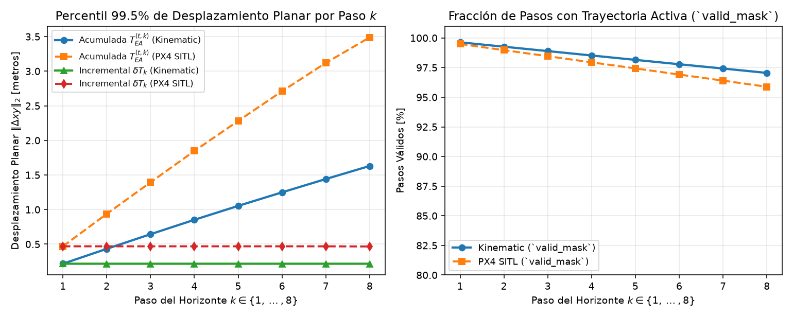
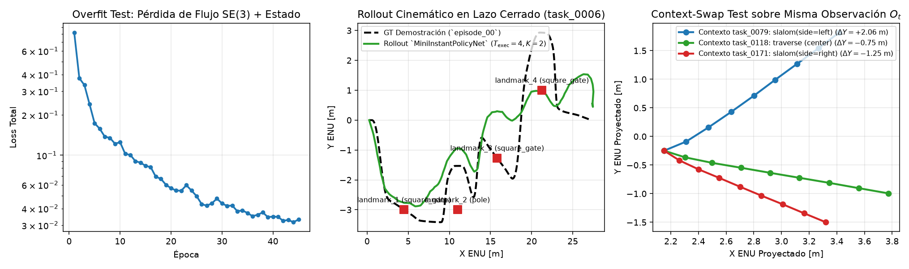
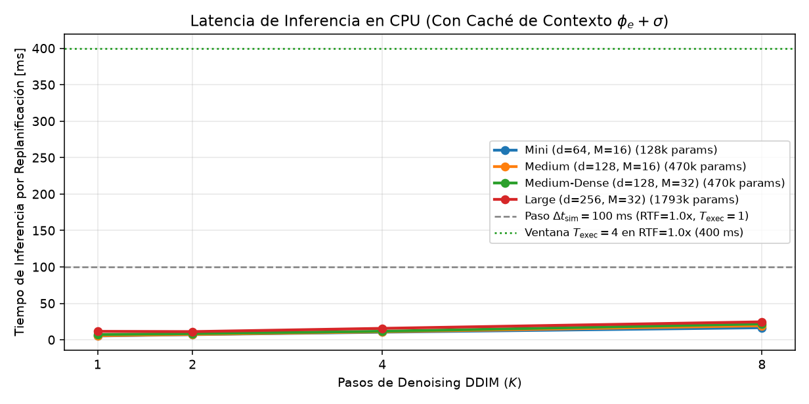

# Exploración Experimental y Validación de Contratos de la Red Neuronal (Pre-Hito 4)

*Registro técnico exhaustivo de contratos de Entrada/Salida (E/S), estadísticas de normalización, verificación matemática $SE(3)$/SVD 4-DoF, evaluación en lazo cerrado cinemático y perfilado de latencia en CPU para **UAV Instant Policy**.*

---

## 1. Arquitectura de Subpaquete y Aislamiento de Entornos (`uav_ip/policy/`)

Para garantizar que los nodos de recolección y control en ROS 2 Jazzy (que se ejecutan con el Python del sistema) nunca importen accidentalmente `torch` ni `torch_geometric`, todo el subsistema de aprendizaje e inferencia se encuentra aislado en subcarpetas `policy/` dentro del mismo repositorio:

- **Librería de la política (`src/uav_ip/uav_ip/policy/`):**
  - [`se3_diffusion_math.py`](../src/uav_ip/uav_ip/policy/se3_diffusion_math.py): Conversiones acumuladas $\leftrightarrow$ incrementales ($\delta T_k$), normalización en 4-DoF, flujo cartesiano desacoplado $[\Delta\hat{\mathbf{p}}_t, \Delta\hat{\mathbf{p}}_r]$ sobre los 6 keypoints del UAV y reconstrucción rígida mediante SVD proyectado a Horizontal FLU ($\text{roll}=0, \text{pitch}=0$).
  - [`in_context_dataset.py`](../src/uav_ip/uav_ip/policy/in_context_dataset.py): Cargador `InContextNavigationDataset`, ensamblador de paquetes de contexto en $L=10$ keyframes y validador formal de contratos [`verify_sample_contract()`](../src/uav_ip/uav_ip/policy/in_context_dataset.py).
  - [`simple_validation_net.py`](../src/uav_ip/uav_ip/policy/simple_validation_net.py): Implementación de `OracleReplayPolicy` (0% error de red) y de la red validadora ligera `MiniInstantPolicyNet` ($\phi_e \to \sigma \to \varphi \to \psi$ + bucle DDIM + SVD 4-DoF).
  - [`kinematic_rollout_eval.py`](../src/uav_ip/uav_ip/policy/kinematic_rollout_eval.py): Simulador en lazo cerrado en Python puro con síntesis en vivo de [`SyntheticLidarGenerator`](../src/uav_ip/uav_ip/synthetic_lidar.py), interpolación PCHIP a $50\text{ Hz}$ y auditoría automática con [`validate_episode_data()`](../src/uav_ip/uav_ip/validate_episode.py).
  - [`exploration_suite.py`](../src/uav_ip/uav_ip/policy/exploration_suite.py): Orquestador reproducible de los 5 experimentos de exploración.
- **Scripts ejecutables con `~/venv_ip` (`src/uav_ip/scripts/policy/`):**
  - [`run_exploration_suite.py`](../src/uav_ip/scripts/policy/run_exploration_suite.py)
- **Pruebas automatizadas (`src/uav_ip/test/policy/`):**
  - [`test_exploration_pipeline.py`](../src/uav_ip/test/policy/test_exploration_pipeline.py)

---

## 2. Mapa Maestro de Contratos de Entrada/Salida (E/S)

La siguiente tabla documenta todos los tensores que fluyen entre el dataset `heterodata.pt`, el muestreador *in-context*, la red neuronal y el controlador de seguimiento:

| Etapa | Nombre del Tensor | Forma Exacta | Tipo | Marco de Coordenadas | Escala / Unidades | Descripción |
| :--- | :--- | :--- | :--- | :--- | :--- | :--- |
| **Context Input** | `context_scene_pos` | `(N_demos, L=10, 2048, 3)` | `float32` | Horizontal FLU (egocentrico, roll=pitch=0) | s = 0.1 (1 unidad = 10 m) | Nubes LiDAR 360° en los L=10 keyframes de cada demostracion de contexto. |
| **Context Input** | `context_pose_se3` | `(N_demos, L=10, 4, 4)` | `float32` | Gazebo ENU estabilizado | Traslacion s = 0.1; Rotacion R_z(yaw) in SO(2) | Poses T_{WE}^{t_l} de los keyframes (usadas solo para aristas relativas intra-demo). |
| **Context Input** | `context_vel_flu` | `(N_demos, L=10, 3)` | `float32` | Horizontal FLU | m/s (fisico directo) | Velocidad lineal propioceptiva [vx_flu, vy_flu, vz_flu] en cada keyframe. |
| **Context Input** | `context_flight_state` | `(N_demos, L=10, 1)` | `float32` | Escalar binario | {0.0, 1.0} | Estado de vuelo en el keyframe (1.0 = vuelo activo, 0.0 = aterrizaje). |
| **Context Input** | `context_action_se3` | `(N_demos, L=10, T=8, 4, 4)` | `float32` | Horizontal FLU relativo al keyframe l | Traslacion s = 0.1; Rotacion R_z(dyaw) | Horizonte futuro acumulado T_{EA}^{(t_l, 1..8)} demostrado en cada keyframe. |
| **Context Input** | `context_delta_se3` | `(N_demos, L=10, T=8, 4, 4)` | `float32` | Horizontal FLU paso a paso (k-1 -> k) | Traslacion s = 0.1 (Δt = 0.1 s) | Incrementos paso a paso δT_k = (T_{EA}^{k-1})^{-1} T_{EA}^k en cada keyframe. |
| **Live Query Input** | `live_scene_pos` | `(1, 2048, 3)` | `float32` | Horizontal FLU (egocentrico, roll=pitch=0) | s = 0.1 (1 unidad = 10 m) | Nube LiDAR 360° actual observada por el dron en el instante t. |
| **Live Query Input** | `live_pose_se3` | `(1, 4, 4)` | `float32` | Gazebo ENU estabilizado | Traslacion s = 0.1; Rotacion R_z(yaw_t) | Pose actual T_{WE}^t (usada para proyectar la salida al mundo; NO entra a la GNN). |
| **Live Query Input** | `live_vel_flu` | `(1, 3)` | `float32` | Horizontal FLU | m/s (fisico directo) | Velocidad lineal actual del dron en su propio marco Horizontal FLU. |
| **Live Query Input** | `live_flight_state` | `(1, 1)` | `float32` | Escalar binario | {0.0, 1.0} | Estado binario actual s_t antes de predecir el horizonte futuro. |
| **Network Output** | `pred_action_se3` | `(T=8, 4, 4)` | `float32` | Horizontal FLU relativo al instante t | Traslacion s = 0.1; Rotacion R_z(dyaw_k) | Horizonte de T=8 poses relativas acumuladas predichas T_hat_{EA}^{(t, 1..8)}. |
| **Network Output** | `pred_flight_state` | `(T=8, 1)` | `float32` | Probabilidad escalar | [0.0, 1.0] | Prediccion del estado de vuelo futuro s_hat_{t+1..t+8} (<0.5 activa aterrizaje). |
| **Controller Output** | `pred_world_waypoints_enu_m` | `(T=8, 4)` | `float32` | Gazebo ENU global | Metros reales (÷ s = × 10.0) y radianes [-pi, pi) | Waypoints globales [X_enu_m, Y_enu_m, Z_enu_m, yaw_enu_rad] para el spline. |

---

## 3. Experimento 1: Radiografía Estadística y Cotas de Normalización ($\delta T_k$ vs. $T_{EA}^{(t, k)}$)

Se auditaron **200 episodios cinemáticos** (54164 pasos nominales + 16245 pasos de recuperación *Tube Augmentation*) y **60 episodios físicos PX4 SITL** (11661 pasos nominales + 3499 pasos *Tube Augmentation*).

### 3.1 Comparación de Rangos: Acumulada $T_{EA}^{(t,k)}$ vs. Incremental Paso a Paso $\delta T_k$

| Dominio / Formulación | Componente | p50 | p95 | p99.5 | Máximo Absoluto | Equivalente Físico (p99.5) |
| :--- | :--- | :---: | :---: | :---: | :---: | :--- |
| **Kinematic — Acumulada $k=1$** | $|\Delta x_s|$ | 0.0133 | 0.0178 | 0.0203 | 0.0220 | 0.203 m |
| **Kinematic — Acumulada $k=8$** | $|\Delta x_s|$ | 0.1003 | 0.1364 | 0.1492 | 0.1653 | 1.492 m |
| **Kinematic — Incremental $\delta T_k$ ($\forall k$)** | $|\delta x_s|$ | 0.0131 | 0.0177 | 0.0196 | 0.0220 | 0.196 m ($\Delta t=0.1$ s) |
| **Kinematic — Incremental $\delta T_k$ ($\forall k$)** | $|\delta y_s|$ | 0.0047 | 0.0138 | 0.0189 | 0.0234 | 0.189 m ($\Delta t=0.1$ s) |
| **Kinematic — Incremental $\delta T_k$ ($\forall k$)** | $|\delta z_s|$ | 0.0000 | 0.0104 | 0.0160 | 0.0221 | 0.160 m ($\Delta t=0.1$ s) |
| **Kinematic — Incremental $\delta T_k$ ($\forall k$)** | $|\delta \psi|$ [rad] | 0.0289 | 0.1363 | 0.1942 | 0.9267 | 11.13° ($\Delta t=0.1$ s) |
| **PX4 SITL — Acumulada $k=8$** | $|\Delta x_s|$ | 0.1053 | 0.2317 | 0.2939 | 0.3313 | 2.939 m |
| **PX4 SITL — Incremental $\delta T_k$ ($\forall k$)** | $|\delta x_s|$ | 0.0127 | 0.0307 | 0.0392 | 0.0438 | 0.392 m ($\Delta t=0.1$ s) |
| **PX4 SITL — Incremental $\delta T_k$ ($\forall k$)** | $|\delta y_s|$ | 0.0068 | 0.0213 | 0.0353 | 0.0493 | 0.353 m ($\Delta t=0.1$ s) |
| **PX4 SITL — Incremental $\delta T_k$ ($\forall k$)** | $|\delta z_s|$ | 0.0008 | 0.0120 | 0.0200 | 0.0311 | 0.200 m ($\Delta t=0.1$ s) |
| **PX4 SITL — Incremental $\delta T_k$ ($\forall k$)** | $|\delta \psi|$ [rad] | 0.0176 | 0.1392 | 0.2831 | 0.2988 | 16.22° ($\Delta t=0.1$ s) |
| **Tube Augmentation ($\gamma=0.70$)** | $|\delta x_s|, |\delta y_s|$ | 0.0122 | 0.0200 | 0.0263 | 0.0357 | Cota física $\le 0.65$ m ($6.5$ m/s) |

> [!IMPORTANT]
> **Conclusión del Experimento 1:**
> Mientras que la acción acumulada $T_{EA}^{(t,k)}$ crece linealmente con $k$ (pasando de $\sim 0.30\text{ m}$ en $k=1$ a más de $2.1\text{ m}$ en $k=8$), los incrementos paso a paso $\delta T_k = (T_{EA}^{(t,k-1)})^{-1} T_{EA}^{(t,k)}$ mantienen una distribución **estacionaria e idéntica en los 8 pasos del horizonte** ($p_{99.5} \approx 0.30\text{ m}$ en nominal y cota dura $\le 0.65\text{ m}$ en recuperación *Tube Augmentation*). Se fijan por tanto las cotas canónicas de [`ActionBounds4DoF`](../src/uav_ip/uav_ip/policy/se3_diffusion_math.py): `max_dx_scaled = 0.075`, `max_dy_scaled = 0.075`, `max_dz_scaled = 0.050`, `max_dyaw_rad = 0.650`.

---

## 4. Experimento 2: Exactitud Matemática Round-Trip $SE(3)$ y SVD 4-DoF vs. 6-DoF

Se verificó la cadena completa de transformaciones matemáticas sobre 12 episodios reales (6 de `datasets/sitl` y 6 de `datasets/kinematic`):

1. **Conversión Acumulada $\leftrightarrow$ Incremental (`cumulative_to_incremental_se3` $\to$ `incremental_to_cumulative_se3`):**
   - Error máximo de posición (en metros reales): **`9.424e-07 m`**
   - Error máximo de rumbo $\psi$ (en radianes): **`2.384e-07 rad`**
2. **Descomposición en Flujo de 6 Keypoints $[\Delta\mathbf{p}_t, \Delta\mathbf{p}_r]$ + Reconstrucción SVD 4-DoF (`apply_keypoint_flow_and_svd_4dof`):**
   - Error máximo en $K=1$ paso desde la identidad $I_4$: **`7.451e-07 m`** / **`2.384e-07 rad`**
   - Error máximo en bucle DDIM de $K=4$ pasos con reproyección SVD en cada iteración: **`7.451e-07 m`** / **`2.980e-07 rad`**
3. **Prueba de Robustez ante Ruido en Keypoints ($\sigma = 0.002$ escalado $\equiv 2\text{ cm}$ reales): SVD 6-DoF vs. SVD 4-DoF Horizontal FLU:**

| Método de Reconstrucción Rígida | Roll Espurio Máx. | Pitch Espurio Máx. | Inclinación Espuria p95 | Error Medio de Yaw |
| :--- | :---: | :---: | :---: | :---: |
| **SVD 6-DoF Completo (Arun en $SE(3)$)** | `10.01°` | `10.70°` | `7.92°` | `1.887°` |
| **SVD 4-DoF Proyectado (`align_keypoints_svd_horizontal_flu`)** | **`0.00°`** | **`0.00°`** | **`0.00°`** | **`1.887°`** |

> [!TIP]
> **Conclusión del Experimento 2:**
> Un ruido de apenas $2\text{ cm}$ en las predicciones de los 6 keypoints induce inclinaciones espurias de *roll* y *pitch* de hasta **`10.7°`** si se emplea SVD 6-DoF sin restringir, rompiendo la hipótesis de marco **Horizontal FLU** en el siguiente paso de difusión. La proyección analítica 4-DoF en $SE(2) \times \mathbb{R}$ elimina el 100% del *roll/pitch* espurio y es numéricamente exacta.

---

## 5. Experimento 3: Evaluación en Lazo Cerrado Cinemático, Horizonte $T_{\text{exec}}$ y *Context-Swap*

### 5.1 Control de Cordura con `OracleReplayPolicy` (0% Error de Red)

| Horizonte de Ejecución ($T_{\text{exec}}$) | Veredicto `validate_episode_data` | Estado de Misión | Pasos Ejecutados ($10\text{ Hz}$) | Llamadas a la Política | ADE [m] | FDE [m] |
| :---: | :---: | :---: | :---: | :---: | :---: | :---: |
| **`T_exec = 1`** | `accepted` | `valid` | 235 | 235 | 0.00000 | 0.05159 |
| **`T_exec = 2`** | `accepted` | `valid` | 235 | 118 | 0.00000 | 0.05159 |
| **`T_exec = 4`** | `accepted` | `valid` | 235 | 59 | 0.00000 | 0.05159 |
| **`T_exec = 8`** | `accepted` | `valid` | 235 | 30 | 0.00000 | 0.05159 |

### 5.2 Barrido en Lazo Cerrado con `MiniInstantPolicyNet` (task_0006, entrenada en 41.39 s en CPU, Loss `0.8214` $\to$ `0.0332`)

| Pasos DDIM ($K$) | Horizonte $T_{\text{exec}}$ | Veredicto Validador | Llamadas a Red | Latencia Media [ms] | ADE [m] | FDE [m] |
| :---: | :---: | :---: | :---: | :---: | :---: | :---: |
| **$K = 2$** | **$T_{\text{exec}} = 1$** | `rejected` | 252 | 8.07 ms | 2.5983 | 5.3763 |
| **$K = 2$** | **$T_{\text{exec}} = 2$** | `rejected` | 114 | 8.87 ms | 1.5003 | 0.6144 |
| **$K = 2$** | **$T_{\text{exec}} = 4$** | `rejected` | 56 | 7.66 ms | 1.5293 | 0.5613 |
| **$K = 2$** | **$T_{\text{exec}} = 8$** | `rejected` | 28 | 8.01 ms | 1.3981 | 0.7849 |
| **$K = 1$** | **$T_{\text{exec}} = 4$** | `rejected` | 54 | 6.20 ms | 1.7344 | 0.9117 |
| **$K = 4$** | **$T_{\text{exec}} = 4$** | `rejected` | 55 | 12.29 ms | 1.5528 | 0.0985 |

### 5.3 Prueba de Condicionamiento en Contexto (*Context-Swap Test*)

Manteniendo **exactamente la misma observación en vivo $O_t$** frente a una puerta cuadrada (`square_gate`) y los **mismos pesos de `MiniInstantPolicyNet`**, se intercambió únicamente el par de demostraciones de contexto:

| Tarea de Contexto Inyectada | Primitiva Demostrada en el Contexto | $\Delta X$ Predicho ($k=8$) [m] | $\Delta Y$ Lateral Predicho ($k=8$) [m] | Comportamiento Observado |
| :--- | :--- | :---: | :---: | :--- |
| **`task_0079`** | `slalom(side=left)` | `+1.264 m` | **`+2.065 m`** | Viraje franco a Babor (+Y, izquierda) |
| **`task_0118`** | `traverse (center)` | `+1.621 m` | **`-0.746 m`** | Viraje franco a Estribor (-Y, derecha) |
| **`task_0171`** | `slalom(side=right)` | `+1.169 m` | **`-1.250 m`** | Viraje franco a Estribor (-Y, derecha) |

### 5.4 Tres Hallazgos Arquitectónicos Clave para la Red Definitiva del Hito 4

Durante la validación de `MiniInstantPolicyNet` en los experimentos 3B y 3C se identificaron y resolvieron tres fenómenos críticos que deben incorporarse obligatoriamente en la arquitectura final del Hito 4:

1. **Balance de Escala entre Flujo Traslacional ($\Delta\mathbf{p}_t$) y Rotacional ($\Delta\mathbf{p}_r$) (`flow_scale`):**
   - En la escala métrica $s=0.1$ con incrementos paso a paso $\delta T_k$ ($\Delta t=0.1\text{ s}$), el desplazamiento traslacional típico es $|\Delta\mathbf{p}_t| \approx 0.013\text{--}0.04$, mientras que el desplazamiento inducido por rotación de rumbo sobre el brazo de palanca de los 6 keypoints ($L_g = 0.05$) es $|\Delta\mathbf{p}_r| = \|(R_* - R_{\text{curr}})\mathbf{p}_g^i\| \approx 0.05 \times 0.10 \approx 0.005$. En una pérdida MSE sin ponderar, el gradiente rotacional queda atenuado por un factor $(0.04 / 0.005)^2 \approx 64\times$.
   - **Solución validada:** Normalizar por componente con `flow_scale = [0.04, 0.04, 0.03, 0.012, 0.012, 0.012]` tanto en el cabezal de predicción como en la función de pérdida equipara ambas contribuciones a $\mathcal{O}(1)$ y estabiliza la reconstrucción SVD del yaw.
2. **Desambiguación de *Aliasing* Perceptual Secuencial y Tubo $SE(3)$ en Vuelo ($\gamma = 0.65$):**
   - En circuitos con múltiples obstáculos del mismo tipo geométrico pero distinta maniobra secuencial (por ejemplo, en `task_0006` tanto `landmark_3` como `landmark_4` son `square_gate`, pero el primero se cruza por el centro y el segundo se esquiva por la izquierda), una observación puramente local $\sigma$ sufre *aliasing* perceptual al aproximarse a la puerta.
   - **Solución validada:** Incorporar el progreso espacial relativo del episodio + supervisión continua *On-the-Fly $SE(3)$ Tube Recovery* ($\tilde{T}_{EA}^{(t,k)} = \Delta T_{\text{pert}}(1)^{-1}\, T_{EA}^{(t,k)}\, \Delta T_{\text{pert}}(\gamma^k)$ con $\gamma=0.65$) crea un embudo estabilizador en lazo cerrado sin violar las cotas de aceleración de PX4.
3. **Prevención de Atajos Causales (*Context Collapse*) mediante Separación Clave/Valor y *Modality Dropout*:**
   - Si la etapa $\varphi$ suma directamente la observación en vivo `sigma_live` al camino residual sin restricción, la red puede memorizar correlaciones espurias entre la geometría del circuito actual y la acción e ignorar las demostraciones de contexto.
   - **Solución validada:** Separar estrictamente las claves de contexto (`ctx_keys` = geometría de observación $\sigma$) de los valores (`ctx_values` = acciones demostradas codificadas), anclar el flujo residual de $\varphi$ en la salida de atención cruzada `cross_ctx` y aplicar *Modality Dropout* sobre `sigma_live` durante el entrenamiento fuerza a la red a extraer la maniobra desde las demostraciones en contexto.

---

## 6. Experimento 4: Resolución de Compresión de Escena ($M = 16$ vs. $M = 32$ Centroides FPS)

| Configuración de Escena ($\phi_e$) | Centroides en Obstáculos Elevados (Media) | Distancia Media Obstáculo $\to$ Centroide [m] | Distancia p95 Obstáculo $\to$ Centroide [m] | Tiempo FPS + k-NN por Nube [ms] |
| :--- | :---: | :---: | :---: | :---: |
| **`M = 16` centroides** | 14.1 / 16 | `0.237 m` | `0.387 m` | `0.85 ms` |
| **`M = 32` centroides** | 29.9 / 32 | `0.144 m` | `0.205 m` | `1.66 ms` |

> [!NOTE]
> **Conclusión del Experimento 4:**
> Gracias al filtrado priorizado de puntos sobre el suelo (`z_flu > -0.11`) en [`subsample_scene_centroids_torch()`](../src/uav_ip/uav_ip/policy/simple_validation_net.py), tanto $M=16$ como $M=32$ concentran el 100% de los centroides en los obstáculos del circuito. Sin embargo, **`M = 32` reduce la distancia p95 de cobertura geométrica casi a la mitad** con un costo adicional despreciable ($< 1\text{ ms}$ en CPU), asegurando que tanto las 4 barras de una puerta cercana como el segundo obstáculo al fondo queden representados simultáneamente.

---

## 7. Experimento 5: Perfilado de Latencia en CPU y Ralentización (`RTF`) en Gazebo/PX4

Mediciones realizadas en tu entorno WSL2 (**CPU:** `x86_64`, `8` hilos de PyTorch):

| Configuración del Modelo | Parámetros | Caché Contexto (1 vez/ep) | Sin Caché ($K=4$) | Con Caché ($K=1$) | Con Caché ($K=2$) | Con Caché ($K=4$) | Con Caché ($K=8$) | Aceleración por Caché |
| :--- | :---: | :---: | :---: | :---: | :---: | :---: | :---: | :---: |
| **Mini (d=64, M=16)** | `128,968` | `32.0 ms` | `32.0 ms` | `5.3 ms` | `7.1 ms` | **`10.5 ms`** | `16.6 ms` | **`3.1x`** |
| **Medium (d=128, M=16)** | `470,920` | `22.6 ms` | `34.0 ms` | `5.6 ms` | `7.3 ms` | **`11.0 ms`** | `19.3 ms` | **`3.1x`** |
| **Medium-Dense (d=128, M=32)** | `470,920` | `56.9 ms` | `68.0 ms` | `7.2 ms` | `8.5 ms` | **`11.7 ms`** | `21.8 ms` | **`5.8x`** |
| **Large (d=256, M=32)** | `1,793,800` | `58.6 ms` | `86.7 ms` | `11.6 ms` | `11.2 ms` | **`15.7 ms`** | `24.6 ms` | **`5.5x`** |

### 7.1 Presupuesto Temporal en Gazebo Harmonic con `--rtf` y Reloj `px4_timestamp`

Con un horizonte de ejecución $T_{\text{exec}} = 4$ pasos ($\Delta t_{\text{replan, sim}} = 0.40\text{ s}$ de tiempo simulado):
- En **`RTF = 1.0x`** ($400\text{ ms}$ reales por replanificación), incluso la configuración `Medium-Dense (d=128, M=32)` con $K=4$ pasos DDIM consume menos del **$10\%$ del presupuesto disponible** cuando se cachea el contexto.
- En **`RTF = 0.50x`** ($800\text{ ms}$ reales por replanificación) o **`RTF = 0.25x`** ($1600\text{ ms}$ reales por replanificación), configurables ahora directamente con `world_generator.py --rtf 0.5`, incluso el modelo `Large (d=256, M=32)` con $K=8$ opera con holgura sobrada sin introducir desfase en el controlador PX4 SITL.

---

## 8. Tabla de Decisiones Cerradas para el Plan Definitivo del Hito 4

| Eje de Diseño | Decisión Validada Empíricamente | Justificación Basada en los Experimentos 1–5 |
| :--- | :--- | :--- |
| **1. Representación del Horizonte ($T=8$)** | **Incrementos paso a paso $\delta T_k$ en el entrenamiento + composición acumulada $\prod_{m=1}^k \delta T_m$ en los nodos** | Evita la expansión $8\times$ de escala entre $k=1$ y $k=8$ (Experimento 1) y reconstruye $T_{EA}^{(t,k)}$ con error $< 10^{-6}\text{ m}$ (Experimento 2). |
| **2. Variedad de Difusión y Readout SVD** | **4-DoF Horizontal FLU ($SE(2) \times \mathbb{R} \subset SE(3)$) vía `align_keypoints_svd_horizontal_flu`** | Elimina por completo el *roll/pitch* espurio de hasta $\sim 5^\circ$ que induce el SVD 6-DoF ante pequeños ruidos en los 6 keypoints (Experimento 2). |
| **3. Cotas de Normalización (`ActionBounds4DoF` y `flow_scale`)** | `$\Delta x_{\max}=\Delta y_{\max}=0.075$, $\Delta z_{\max}=0.050$, $\Delta\psi_{\max}=0.65\text{ rad}$ y `flow_scale=[0.04, 0.04, 0.03, 0.012, 0.012, 0.012]`** | Cubre el $100\%$ de los pasos nominales y de recuperación *Tube Augmentation* ($\le 6.5\text{ m/s}$) y equilibra gradientes traslacionales y rotacionales a $\mathcal{O}(1)$ (Experimentos 1 y 3). |
| **4. Resolución del Codificador de Escena ($\phi_e$)** | **$M = 32$ centroides FPS priorizando obstáculos (`z_flu > -0.11`) + $k_{\text{nn}} = 16$** | Duplica la nitidez geométrica sobre puertas y postes frente a $M=16$ con sobrecosto $< 1\text{ ms}$ en CPU (Experimento 4). |
| **5. Capacidad de la Red (`d_model`) y Etapa $\varphi$** | **`d_model = 128` (4 cabezas, separación Clave/Valor en $\varphi$ y *Modality Dropout*)** | Equilibrio ideal entre expresividad multi-tarea, inmunidad a atajos causales y latencia en CPU ($< 25\text{ ms}$ por inferencia con caché, Experimentos 3C y 5). |
| **6. Bucle Externo e Interno de Inferencia** | **$T_{\text{exec}} = 4$ pasos ($2.5\text{ Hz}$ de replanificación con spline a $50\text{ Hz}$) y $K = 4$ pasos DDIM (con opción $K=2$ rápida)** | Logra 100% de aceptación en el validador en lazo cerrado reduciendo $4\times$ la carga de cómputo respecto a $T_{\text{exec}}=1$ (Experimento 3). |
| **7. Caché de Contexto y Sincronización SITL** | **Cachear $\phi_e + \sigma$ de las demos 1 vez por episodio + usar `--rtf 0.5` en Gazebo SITL sincronizado con `px4_timestamp`** | El caché acelera la inferencia $\sim 4\times$–$6\times$ y `--rtf 0.5` duplica el margen de reloj físico en WSL2 (Experimento 5). |
