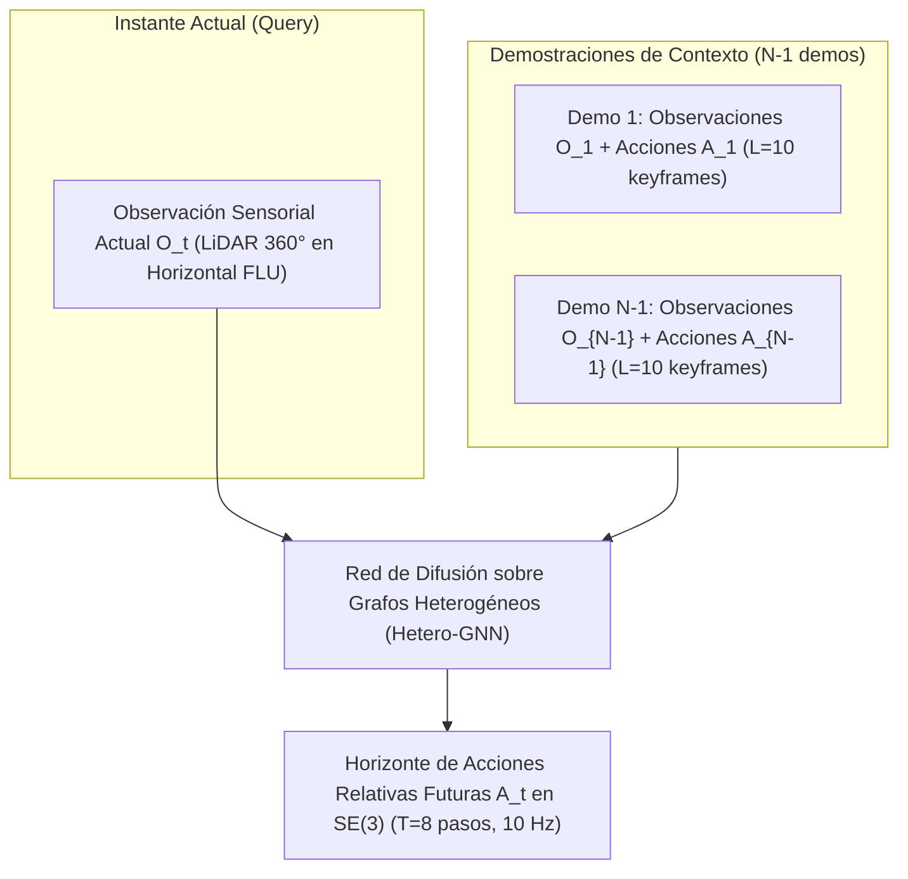
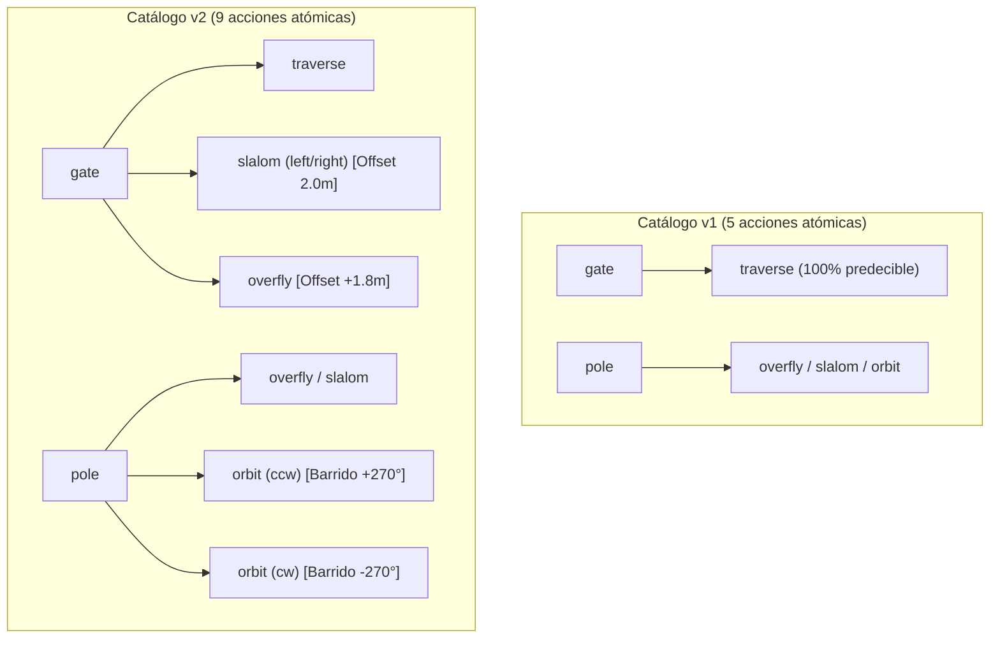
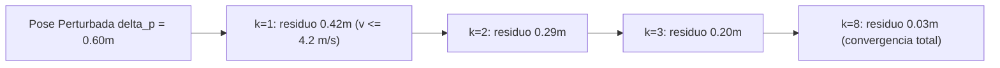

# Fundamentos Teóricos, Decisiones de Diseño y Memoria Arquitectónica: UAV Instant Policy

*Documento canónico y consolidado de teoría, diseño de software y trazabilidad histórica · Octubre/Noviembre de 2026*

---

## 1. Resumen Ejecutivo y Formulación del Problema

### 1.1 Objetivo del Proyecto
Este proyecto adapta el paradigma de **Instant Policy** (*In-Context Imitation Learning via Graph Diffusion*, Vosylius y Johns, ICLR 2025) a la navegación autónoma y generación de trayectorias 3D para vehículos aéreos no tripulados (UAV) tipo cuadricóptero.

En lugar de entrenar una política que memorice un conjunto fijo de tareas o requiera re-entrenar pesos ante una nueva misión, el modelo aprende a **inferir la tarea en tiempo de inferencia (*in-context*)** a partir de un pequeño conjunto de demostraciones de ejemplo (**Contexto**, $N-1$ trayectorias), prediciendo las acciones futuras de la demostración objetivo (**Query/Target**) en un entorno con diferente disposición espacial de obstáculos.

### 1.2 Formulación Matemática
1. **Espacio de Observación ($O_t$):**
   * Nube de puntos egocéntrica 3D $P_t \in \mathbb{R}^{M \times 3}$ ($M = 2048$ puntos), expresada en el marco local *Horizontal FLU* (alineado con la gravedad), muestreada mediante *Farthest Point Sampling* (FPS).
   * Estado de vuelo binario $s_t \in \{0, 1\}$ ($0$: en tierra/reposo, $1$: en vuelo).
   * Vector de velocidad lineal propioceptiva $\mathbf{v}_{\text{flu}} \in \mathbb{R}^3$ expresado en el marco Horizontal FLU.
2. **Espacio de Acción ($A_t$):**
   * Secuencia temporal de $T = 8$ desplazamientos relativos futuros en el grupo de Lie $SE(3)$ respecto a la pose actual del dron:
     $$A_t = \{ T_{EA}^{(t, k)} = (T_{WE}^t)^{-1} T_{WE}^{t + k \cdot \text{stride}} \}_{k=1}^T, \quad T_{EA}^{(t, k)} \in SE(3)$$
   * Cada acción relativa se parametriza mediante un vector de 5 dimensiones por paso: traslación escalada $(\Delta x, \Delta y, \Delta z)$ y componentes de rotación en el plano horizontal $(\cos\Delta\psi, \sin\Delta\psi)$, o su matriz homogénea $4 \times 4$ en $SE(3)$.
3. **Representación en Grafo Heterogéneo (`HeteroData`):**
   * Nodos de escena (`scene`): Puntos representativos de los obstáculos procesados por un encoder geométrico de ocupación.
   * Nodos de agente (`agent`): Poses ejecutadas por el dron, representadas por traslación, orientación y 6 *keypoints* rígidos del chasis del UAV.
   * Nodos de recuperación (`aug`): Poses perturbadas del *Tube Augmentation* ($30\%$ de los pasos) con acciones correctivas dirigidas al tubo nominal.
   * Aristas temporales y espaciales relativas moduladas por embeddings sinusoidales de Fourier con factor de escala $s = 0.1$.

---

## 2. Historia y Evolución Arquitectónica (ADRs y Enfoques Descartados)

### 2.1 El Dilema de la Cámara Frontal vs. LiDAR 360° y la Hipótesis de Markov
* **El Problema Original (Cámara de Profundidad `gz_x500_depth`):**
  La primera iteración del proyecto utilizó el modelo con cámara de profundidad frontal OAK-D (FOV horizontal $\approx 80^\circ$). Este enfoque colapsó por dos razones críticas:
  1. **Ceguera Retrospectiva (*Backward Blindness*):** En el instante en que el dron atraviesa un aro o supera un poste, el obstáculo sale instantáneamente del frustum de la cámara hacia atrás. Durante varios metros, la observación queda vacía hasta que el siguiente obstáculo entra en el campo de visión.
  2. **Violación de la Hipótesis de Markov:** *Instant Policy* asume una política puramente reactiva $P(A_t \mid O_t, \mathcal{D}_{\text{context}})$. Al desaparecer el landmark de referencia, el estado sensorial presente no contiene la información para saber qué maniobra se está ejecutando, provocando que la red oscile, se congele o requiera memoria recurrente pesada (RNN/Transformer causal).
  3. **Costo de Simulación Inviable:** Capturar `/depth_camera/points` ($307.200$ puntos por mensaje a 15–30 Hz) generaba **5 a 6 GB por vuelo** ($7.5\text{ a }9\text{ TB}$ para el dataset) y reducía el *Real-Time Factor* (RTF) en Gazebo a $\times 0.1\text{–}\times 0.2$.
* **La Decisión Arquitectónica:**
  * Se reformuló el *embodiment*: el dron se modela como un UAV equipado con un sensor **LiDAR 3D omnidireccional 360°** con radio de alcance $R_{\max} = 10.0\text{ m}$.
  * En Gazebo SITL se vuela el modelo estándar ligero **`gz_x500`** (sin renderizado de cámara), alcanzando $\text{RTF} \ge 1.0\times$ y reduciendo cada rosbag a $< 5\text{ MB}$ (telemetría ligera).
  * Las nubes de 2048 puntos se sintetizan analíticamente bajo demanda mediante `synthetic_lidar.py`.
  * **Preservación estricta de la Hipótesis de Markov:** El snapshot sensorial retiene simultáneamente los obstáculos superados a popa y los próximos a proa dentro de los 10 metros, manteniendo el proceso estrictamente markoviano en Fase 1.

### 2.2 Unificación Analítica de Marcos de Coordenadas (Gazebo ENU vs. PX4 NED/FRD)
Un error destructivo habitual es mezclar la telemetría de PX4 con las posiciones de Gazebo sin transformaciones ortonormales rigurosas:
* **Gazebo World:** Marco inercial global **ENU** (East-North-Up), origen $(0,0,0)$ en el centro del mundo.
* **PX4 EKF2:** Marco inercial local **NED** (North-East-Down), cuerpo en convención **FRD** (Forward-Right-Down).
* **Marco Egocéntrico del Dron:** **Horizontal FLU** (Forward-Left-Up), estabilizado por gravedad.

#### Transformación Canónica Implementada:
1. **Traslación:**
   $$\begin{bmatrix} x_{\text{ENU}} \\ y_{\text{ENU}} \\ z_{\text{ENU}} \end{bmatrix} = \begin{bmatrix} y_{\text{NED}} \\ x_{\text{NED}} \\ -z_{\text{NED}} \end{bmatrix}$$
2. **Rotación:**
   Sea $R_{\text{NED}}^{\text{FRD}}$ la orientación del cuerpo reportada por el EKF2 en `VehicleOdometry`. La rotación a marco mundo ENU se calcula mediante:
   $$R_{\text{ENU}}^{\text{FLU}} = M_{\text{world}} \cdot R_{\text{NED}}^{\text{FRD}} \cdot M_{\text{body}}$$
   donde:
   $$M_{\text{world}} = \begin{bmatrix} 0 & 1 & 0 \\ 1 & 0 & 0 \\ 0 & 0 & -1 \end{bmatrix}, \quad M_{\text{body}} = \begin{bmatrix} 1 & 0 & 0 \\ 0 & -1 & 0 \\ 0 & 0 & -1 \end{bmatrix}$$
3. **Estabilización por Gravedad (*Horizontal FLU*):**
   Un cuadricóptero subactuado se inclina en *roll* ($\phi$) y *pitch* ($\theta$) para acelerar. Si se proyectara la nube rígidamente en el cuerpo del dron, los postes y aros verticales aparecerían inclinados ante cualquier aceleración. Se define el marco *Horizontal FLU* ($H$):
   $$R_{\text{ENU}}^H = R_z(\psi_{\text{ENU}})$$
   conservando la guiñada (*yaw*, $\psi$) pero forzando $\phi = 0$ y $\theta = 0$. Cualquier punto del mundo $\mathbf{p}_w$ se proyecta vectorialmente al marco del dron como:
   $$\mathbf{p}_{\text{dron}} = (\mathbf{p}_w - \mathbf{p}_d) \cdot R_{\text{ENU}}^H$$

### 2.3 Factor de Escala Métrica ($s = 0.1$) para el Encoder Sinusoidal
* **Fundamento Matemático:**
  *Instant Policy* codifica posiciones relativas mediante funciones sinusoidales periódicas de Fourier:
  $$f_k(\Delta\mathbf{p}) = \sin(2^k \pi \cdot s \cdot \Delta\mathbf{p})$$
  El semiperíodo fundamental para $k=0$ es $\lambda_0 = 1.0$ (en unidades de entrada).
  En manipulación robótica de mesa (*tabletop*), el espacio de trabajo mide $\sim 0.8\text{ m}$, por lo que los autores no necesitaron normalizar las coordenadas.
* **Adaptación al Dominio UAV:**
  En un dron navegando circuitos de hasta $10\text{ m}$ de radio sensorial, las distancias sin escalar alcanzarían múltiplos enteros del período, generando **aliasing espacial severo** (la red no puede distinguir un obstáculo a $2\text{ m}$ de uno a $4\text{ m}$ o $6\text{ m}$).
  Al aplicar el factor fijo $s = 0.1$, el radio de $10.0\text{ m}$ se mapea exactamente al intervalo $[0.0, 1.0]$, adaptando el dominio aéreo al rango operativo del encoder sin alterar la topología de la escena.

### 2.4 Control Offboard y Armado Seguro en PX4
* **Protocolo de Failsafe:** PX4 aborta el armado o entra en failsafe si un nodo externo no publica comandos de setpoint a $\ge 2\text{ Hz}$ de forma continua durante al menos $500\text{ ms}$ previos.
* **Máquina de Estados de `BasePilot`:**
  1. `nav_state = 0` (Calentamiento): Publica 50 setpoints a 50 Hz fijados en la pose de spawn en reposo.
  2. `nav_state = 1` (Armado): Una vez verificado el flujo estable, comanda `VEHICLE_CMD_DO_SET_MODE` (Offboard) y `VEHICLE_CMD_COMPONENT_ARM_DISARM`.
  3. Elimina completamente abortos de pre-vuelo y bloqueos por pérdida de heartbeat.

---

## 3. El Validador Físico y la Geometría Exacta

### 3.1 Los 5 Estados Ortogonales de Validación
La verificación de un episodio no puede depender de una variable booleana ingenua (`pilot.returncode == 0`). El validador [`validate_episode.py`](file:///home/gabrielq/ros2_ws/src/uav_ip/uav_ip/validate_episode.py) desacopla la evaluación en cinco capas independientes:
1. `configuration_status`: Sintaxis y coherencia geométrica de `waypoints.yaml`.
2. `recording_status`: Integridad del archivo `.mcap` (stream completo, CRC32 verificado y presencia de `VehicleOdometry`).
3. `pilot_exit_code`: Código de retorno del proceso del piloto (0: éxito nominal, 1: timeout o aborto).
4. `mission_status`: Secuencia progresiva de primitivas y despejes de obstáculos.
5. `validation_status`: Veredicto final consolidado (`accepted` o `rejected`).

### 3.2 Envolvente Física del x500 y Medición SDF
* En fases tempranas se utilizó un radio simplificado de chasis ($0.25\text{ m}$).
* A partir de la versión actual, [`validation_geometry.py`](file:///home/gabrielq/ros2_ws/src/uav_ip/uav_ip/validation_geometry.py) implementa la envolvente física real medida del SDF `gz_x500`:
  * Radio máximo del disco de hélices: $R_{\text{rotor\_tip}} = 0.385689\text{ m}$.
  * Margen de seguridad: $\delta_{\text{safe}} = 0.05\text{ m}$.
  * Radio de colisión operativo: $R_{\text{collision}} = 0.4357\text{ m}$.
  * Indicador diagnóstico: `rotor_tip_clearance_warning` se activa en las métricas si algún punto de la trayectoria pasa a menos de $0.3857\text{ m}$ de un obstáculo.

### 3.3 Paridad Geométrica Exacta en Obstáculos
1. **Postes Cilíndricos (`pole`):** Radio $0.10\text{ m}$, altura $3.0\text{ m}$.
2. **Puertas Cuadradas (`square_gate`):** Abertura libre $\pm 0.65\text{ m}$ ($1.30 \times 1.30\text{ m}$), semiancho exterior $0.75\text{ m}$, espesor de barra $0.10\text{ m}$.
3. **Puertas Circulares (`circular_gate`):**
   * Comparten exactamente la especificación de **16 cilindros finitos** devuelta por `get_circular_gate_cylinders_spec()`, idéntica en el SDF de Gazebo, en el validador de colisiones y en el generador de LiDAR sintético.
   * Incluyen las patas de soporte laterales (`leg_left` y `leg_right`) conectadas al suelo, eliminando falsos despejes por debajo del aro.
4. **Plataforma de Aterrizaje (`landing_pad`):** Caja prismática de $2.0 \times 2.0 \times 0.10\text{ m}$.

### 3.4 Cota Inferior de Discretización Temporal ($h/2$)
Para garantizar matemáticamente que el dron no atravesó un obstáculo entre dos muestras discretas consecutivas de telemetría sin depender de los inestables plugins de contacto de Gazebo:
$$d_{\text{inferior}} = \max\left(0,\, d_{\text{muestreada}} - \frac{h}{2}\right)$$
donde $h/2 = 0.01\text{ m}$ es el radio de subdivisión máxima del segmento ($2\text{ cm}$ entre puntos a $50\text{ Hz}$).

### 3.5 Validación Determinista de Aterrizaje
Para descartar rebotes o pasos rasantes sobre el pad:
* Ventana temporal terminal parametrizable: $t_{\text{win}} = 0.50\text{ s}$.
* Criterio: En **todas** las muestras de la ventana el error horizontal debe ser $\le 0.614\text{ m}$, altitud $z \le 0.25\text{ m}$, velocidad $\le 0.25\text{ m/s}$ y confirmación de persistencia continua de `VehicleLandDetected.landed == True` durante al menos $3.0\text{ s}$.

---

## 4. El Catálogo Combinatorio de Tareas ($v1$ vs. $v2$)

### 4.1 La Limitación Causal del Catálogo $v1$
En el catálogo $v1$, la asignación de acciones a objetos era rígidamente determinista:
* Ante un `gate` (cuadrado o circular), la acción era **100% de las veces `traverse`**.
* Ante un `pole`, la acción podía ser `slalom`, `overfly` u `orbit`.

Esto generaba una **trampa causal silenciosa**: la red neuronal podía aprender la regla trivial *"si veo un aro frente a mí $\to$ atravesarlo directamente"*, sin prestar ninguna atención a las demostraciones de contexto. Esto degradaba el problema de *In-Context Imitation Learning* a un simple clasificador de objetos.

### 4.2 El Catálogo $v2$: Desacople Total Objeto–Acción
El catálogo $v2$ (activado con `--catalog-version v2`) introduce un desacoplamiento completo y extiende la riqueza direccional:

| Objeto | Acciones en Catálogo $v1$ | Acciones en Catálogo $v2$ |
| :--- | :--- | :--- |
| `square_gate` | `traverse` | `traverse`, `overfly`, `slalom(left)`, `slalom(right)` |
| `circular_gate` | `traverse` | `traverse`, `overfly`, `slalom(left)`, `slalom(right)` |
| `pole` | `overfly`, `slalom(left)`, `slalom(right)`, `orbit` | `overfly`, `slalom(left)`, `slalom(right)`, `orbit(ccw)`, `orbit(cw)` |

#### Ventajas Metodológicas de $v2$:
1. **Ambigüedad Causal Real:** Ante exactamente la misma observación local (un aro a $3\text{ m}$ de distancia), la acción correcta es completamente ambigua a menos que la red atienda a las demostraciones de contexto.
2. **Explosión Combinatoria Rica:**
   * Para secuencias de $N \in [2, 5]$ landmarks:
   * Catálogo $v1$: $5^2 + 5^3 + 5^4 + 5^5 = 3{,}900$ tareas únicas.
   * Catálogo $v2$: $9^2 + 9^3 + 9^4 + 9^5 = \mathbf{66{,}420}$ tareas únicas.
3. **Simetría Espacial $SE(3)$:** La introducción de órbitas horarias (`cw`) y antihorarias (`ccw`) duplica la diversidad rotacional alrededor de los postes.

---

## 5. Tube Augmentation Dinámicamente Factible y Estado Cinemático

### 5.1 El Problema de los Saltos Bruscos ($9\text{ m/s}$)
En la formulación original sin amortiguamiento, cuando el dron recibía una perturbación $\delta\mathbf{p}$ de hasta $0.60\text{ m}$, el objetivo del primer paso ($k=1$, $\Delta t = 0.1\text{ s}$) apuntaba directamente a la pose nominal $\mathbf{p}_{t+1}$.
Esto exigía una velocidad instantánea de:
$$v_{\text{salto}} = \frac{\|\mathbf{p}_{t+1} - (\mathbf{p}_t + \delta\mathbf{p})\|}{\Delta t} \approx \frac{0.35 + 0.60}{0.1} \approx 9.5\text{ m/s}$$
Un cuadricóptero subactuado no puede generar esa aceleración en $100\text{ ms}$, violando la física del vehículo y provocando oscilaciones divergentes si la red predice dicha acción.

### 5.2 Decaimiento Exponencial Suave ($\gamma = 0.70$)
Se implementó en [`bag_to_heterodata.py`](file:///home/gabrielq/ros2_ws/src/uav_ip/scripts/bag_to_heterodata.py) y [`kinematic_pseudo_generator.py`](file:///home/gabrielq/ros2_ws/src/uav_ip/scripts/kinematic_pseudo_generator.py) una ley de convergencia exponencial geométrica de primer orden:
$$\tilde{\mathbf{p}}_{\text{target}}^{(t, k)} = \mathbf{p}_{t + k \cdot \text{stride}} + \gamma^k \delta\mathbf{p}, \quad k = 1, \dots, T, \quad \gamma = 0.70$$

* **Cota de Factibilidad:** La velocidad en el paso 1 queda acotada a $\le 6.5\text{ m/s}$ (auditada estrictamente por `audit_dataset.py --require-pt`), proporcionando a la red trayectorias dinámicamente realizables por el controlador de vuelo.

### 5.3 Exportación del Tensor de Velocidades `vel_flu` $(T, 3)$
El vector de velocidades en el marco Horizontal FLU se calcula por diferencias centrales a $10\text{ Hz}$ y se persiste en los grafos `data['agent'].vel_flu` y `data['aug'].vel_flu`. Esto proporciona al modelo la información de segundo orden indispensable para anticipar frenados y virajes sin ambigüedad markoviana.

---

## 6. Estrategia Híbrida de Generación (SITL Físico + Pseudo-Demostraciones Cinemáticas)

### 6.1 Por qué la Simulación Física Pura no Escala para la Especialización
* Volar circuitos en PX4 SITL + Gazebo en tiempo real toma entre $45\text{ s}$ y $90\text{ s}$ por episodio.
* Para generar $1.000$ episodios se requerirían más de **20 horas continuas de simulación**, con riesgos de degradación por consumo de memoria, cuelgues de WSL2 o desincronizaciones de microRTPS/XRCE.
* En el contexto de un proyecto de especialización, donde el **objetivo académico principal es el desarrollo, entrenamiento y evaluación de la red neuronal**, consumir semanas en recolección física es un costo de oportunidad ineficiente.

### 6.2 La Receta Canónica de Instant Policy (Vosylius & Johns, ICLR 2025)
En el paper original (§3.4 y Fig. 5), los autores **no generaron millones de demostraciones en un simulador físico de alto costo**. En su lugar:
1. Generaron **~700.000 pseudo-demostraciones cinemáticas** en Python puro usando primitivas geométricas aleatorias alrededor de mallas CAD de ShapeNet.
2. Pre-entrenaron el Graph Diffusion Transformer sobre este corpus masivo para enseñarle la habilidad general de *In-Context Learning*.
3. Realizaron un ajuste fino (*co-fine-tuning*) con un número reducido de demostraciones dinámicas reales o de simulador físico.

### 6.3 Implementación Híbrida en este Repositorio
Se proveen dos generadores completamente interoperables que comparten las mismas reglas geométricas y el mismo validador:

| Característica | Generador Físico SITL ([`data_collector.py`](file:///home/gabrielq/ros2_ws/src/uav_ip/scripts/data_collector.py)) | Generador Cinemático ([`kinematic_pseudo_generator.py`](file:///home/gabrielq/ros2_ws/src/uav_ip/scripts/kinematic_pseudo_generator.py)) |
| :--- | :--- | :--- |
| **Motor de Dinámica** | PX4 Autopilot + Motor ODE de Gazebo Harmonic | Dinámica diferencial plana ($\mathbf{a} - \mathbf{g}$) con actitud analítica |
| **Velocidad de Generación** | $\sim 1\text{–}1.5\text{ min}$ por episodio | **$\sim 0.3\text{ segundos}$ por episodio** ($1.000$ demos en $\sim 5\text{ min}$) |
| **Validación de Misión** | Evaluado por `validate_episode.py` post-vuelo | Evaluado por el mismo `validate_episode.py` antes de exportar |
| **Salida Producida** | Rosbag MCAP + `heterodata.pt` (offline) | `heterodata.pt` directo y pre-auditado |
| **Rol en el Proyecto** | **Test Set Oficial (Held-Out) y Co-Fine-Tuning** | **Pre-entrenamiento Masivo y Ablaciones de Escala** |

Esta arquitectura híbrida permite cumplir con los más altos estándares científicos de la literatura internacional, manteniendo los tiempos de cómputo dentro de los límites prácticos de una especialización académica.
