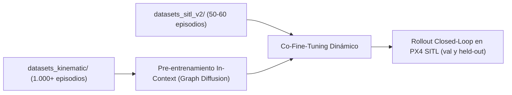

# Hoja de Ruta y Plan Maestro de Implementación: UAV Instant Policy

*Plan maestro de ingeniería de software, pipeline de datos y red neuronal · Actualizado a Noviembre de 2026*

---

## 1. Arquitectura General del Sistema (4 Dominios Desacoplados)

El proyecto estructura el flujo completo desde la generación procedimental hasta el control en lazo cerrado en cuatro dominios funcionales estrictamente desacoplados:

```
┌──────────────────────────────────────────────────────────────────────────────┐
│                     DOMINIO 1: GENERACIÓN PROCEDIMENTAL                      │
│                                                                              │
│   task_generator.py                   world_generator.py                     │
│   (Define firma semántica única       (Instancia poses 3D aleatorias y       │
│    sin reemplazo con catálogo v1/v2)   genera .sdf + waypoints.yaml)         │
└──────────────────────────────────────┬───────────────────────────────────────┘
                                       │
┌──────────────────────────────────────▼───────────────────────────────────────┐
│              DOMINIO 2: GENERACIÓN DE DEMOSTRACIONES (HÍBRIDO)               │
│                                                                              │
│   Ruta A: Simulación Física SITL        Ruta B: Emulación Cinemática Rápida  │
│   data_collector.py (Gazebo+PX4)        kinematic_pseudo_generator.py (50Hz) │
│   - Vuelo de alta fidelidad dinámica    - Genera 1.000 episodios en ~5 min   │
│   - Genera rosbags MCAP ligeros         - Dinámica diferencial (a - g)       │
│   - Test set oficial (Held-out)         - Pre-entrenamiento masivo en escala │
└──────────────────────────────────────┬───────────────────────────────────────┘
                                       │
┌──────────────────────────────────────▼───────────────────────────────────────┐
│               DOMINIO 3: POSTPROCESO OFFLINE Y GRAFOS HETERODATA             │
│                                                                              │
│   synthetic_lidar.py                  bag_to_heterodata.py                   │
│   (Observación 360° en marco          (Extrae poses SE(3), acciones T=8,     │
│    Horizontal FLU, FPS 2048,           keyframes L=10, Tube Augmentation     │
│    escala s=0.1, determinista)         con decaimiento gamma=0.70 y vel_flu) │
│                                                    │                         │
│                                       audit_dataset.py                       │
│                                       (Auditoría 3 capas: finitud, cotas     │
│                                        físicas <=6.5 m/s y splits sin fuga)  │
└──────────────────────────────────────┬───────────────────────────────────────┘
                                       │
┌──────────────────────────────────────▼───────────────────────────────────────┐
│             DOMINIO 4: DIFUSIÓN SOBRE GRAFOS Y CONTROL CLOSED-LOOP           │
│                                                                              │
│   In-Context Graph Sampler            Red de Difusión Hetero-GNN (σ, φ, ψ)   │
│   (N-1 demos contexto [L=10] +      ─►(Encoder escena φ_e + 6 keypoints UAV  │
│    1 observación actual O_t)           + flujo desacoplado DDIM + SVD SE(3)) │
│                                                    │                         │
│                                                    ▼                         │
│                                       Nodo ROS 2 de Inferencia Closed-Loop   │
│                                       (Rollout + filtro B-spline -> PX4)     │
└──────────────────────────────────────────────────────────────────────────────┘
```

---

## 2. Estado Actual de los Módulos de Software

| Módulo / Script | Ubicación | Estado Actual | Rol y Características Principales |
| :--- | :--- | :--- | :--- |
| **`task_generator.py`** | `src/uav_ip/scripts/` | **Completado** | Muestreo combinatorio sin reemplazo, catálogos `v1` (3.900 tareas) y `v2` (66.420 tareas), desacople de acciones en gates y órbitas con sentido de giro (`ccw`/`cw`). |
| **`world_generator.py`** | `src/uav_ip/scripts/` | **Completado** | Generación procedural SDF y `waypoints.yaml`, anillo poligonal de 16 cilindros con patas para `circular_gate`, verificación de factibilidad geométrica de transiciones y offsets adaptativos por landmark. |
| **`base_pilot.py`** | `src/uav_ip/uav_ip/` | **Completado** | Protocolo seguro de armado en modo Offboard (pre-flujo de 50 setpoints a 50 Hz), suscripción a tópicos PX4, registro de frescura de telemetría y conversiones NED/ENU. |
| **`waypoint_controller.py`** | `src/uav_ip/uav_ip/` | **Completado** | Piloto experto con velocidades feed-forward en pasos `pre`/`center`, cruce de plano tangencial en arcos de órbita (sin puntos muertos), soporte de órbita horaria/antihoraria y timeout de aterrizaje ampliado a $18.0\text{ s}$. |
| **`tracking_controller.py`** | `src/uav_ip/uav_ip/` | **Completado** | Prototipo experimental alternativo para seguimiento en lazo cerrado continuo. Documentado formalmente como prototipo fuera del camino crítico de recolección (`B1_CONTINUOUS`). |
| **`data_collector.py`** | `src/uav_ip/scripts/` | **Completado** | Orquestador multi-tarea y multi-episodio para PX4 SITL con reintentos limpios (`episode_XX_attempt_YY`), cooldowns automáticos, tolerancia de argumentos (`--seed`, `--output-dir`) y validación post-vuelo en línea. |
| **`kinematic_pseudo_generator.py`** | `src/uav_ip/scripts/` | **Completado** | Generador ultrarrápido de pseudo-demostraciones cinemáticas a $50\text{ Hz}$ con actitud por dinámica diferencial ($\mathbf{a} - \mathbf{g}$), validado 1-a-1 por el juez geométrico y con exclusión estricta de firmas semánticas (`--exclude-signatures-from`). |
| **`validation_geometry.py`** | `src/uav_ip/uav_ip/` | **Completado** | Fuente única de verdad geométrica con radio físico real del x500 hasta puntas de hélice ($0.3857\text{ m}$), radio de colisión ($0.4357\text{ m}$), tolerancias dinámicas y especificación compartida de obstáculos. |
| **`validate_episode.py`** | `src/uav_ip/uav_ip/` y `scripts/` | **Completado** | Validador independiente de 5 estados (configuración, MCAP/CRC32, odometría obligatoria, misión geométrica y aterrizaje continuo en ventana de $0.50\text{ s}$), soporte multi-segmento para órbitas y advertencia de clearance de pala. |
| **`synthetic_lidar.py`** | `src/uav_ip/uav_ip/` y `scripts/` | **Completado** | Sintetizador LiDAR omnidireccional 360° en marco *Horizontal FLU* ($s=0.1$, 2048 puntos FPS determinista con kernel C SIMD), paridad exacta en aros con patas y cuota acotada en plataforma. |
| **`bag_to_heterodata.py`** | `src/uav_ip/scripts/` | **Completado** | Conversor por lotes a `HeteroData` PyTorch Geometric (.pt) con exportación de velocidades lineales `vel_flu` $(T, 3)$, *Tube Augmentation* con decaimiento exponencial $\gamma = 0.70$ y flags `--require-torch` y `--overwrite`. |
| **`audit_dataset.py`** | `src/uav_ip/scripts/` | **Completado** | Auditoría universal en 3 capas (vuelos brutos, integridad de tensores con cota de velocidad física $\le 6.5\text{ m/s}$, y particionado formal `train`/`val`/`held_out` disjunto por firmas sin fuga de datos). |
| **`visualize_dataset.py`** | `src/uav_ip/uav_ip/` y `scripts/` | **Completado** | Visualizador 3D estático interactivo, generador de animaciones GIF e inspector gráfico de trayectorias de recuperación por *Tube Augmentation* (`--show-aug`). |
| **`setup_venv_ip.sh`** | `src/uav_ip/scripts/` | **Completado** | Instalador automatizado del entorno virtual aislado de Machine Learning `~/venv_ip` (ROS 2/PyTorch/PyG). |

---

## 3. Estado de Hitos del Proyecto

### Hito 0: Pipeline Core E2E y Validación de Vuelo Base — [COMPLETADO]
- [x] Modelo de simulación ligero `gz_x500` ($\text{RTF} \ge 1.0\times$).
- [x] Protocolo de armado seguro a Offboard en `base_pilot.py` (50 setpoints previos a 50 Hz).
- [x] Generador base de LiDAR privilegiado `synthetic_lidar.py` (2048 puntos, FPS, escala $s=0.1$).
- [x] Grabación compacta en rosbags MCAP ($< 5\text{ MB}$ por vuelo).
- [x] Aleatorización espacial intra-tarea determinista.
- [x] Prototipo inicial de conversión a grafos `HeteroData` con `bag_to_heterodata.py`.

### Hito 1: Generación Combinatoria sin Reemplazo y Auditoría Base — [COMPLETADO]
- [x] Catálogo combinatorio dinámico e intercalado en `task_generator.py`.
- [x] Muestreo determinista sin reemplazo vía `--task-index` y `--shuffle-seed`.
- [x] Script de auditoría de firmas semánticas y exportación de splits en `audit_dataset.py`.

### Hito 2: Blindaje contra Falsos Positivos y Validación Rigurosa — [COMPLETADO]
- [x] Validador independiente desacoplado en 5 estados en `validate_episode.py`.
- [x] Verificación de integridad MCAP (recorrido de stream y CRC32 de chunks sin comprimir).
- [x] Diagnóstico estructurado de reloj y reparación auditable de saltos mediante `/fmu/out/timesync_status`.
- [x] Validación determinista de aterrizaje en ventana común ($0.50\text{ s}$) con persistencia continua de $3.0\text{ s}$.
- [x] Cota inferior de discretización $d_{\text{inferior}} = \max(0, d_{\text{muestreada}} - h/2)$ con $h/2 = 0.01\text{ m}$.
- [x] Suite de 63 tests unitarios e integrados pasando al 100%.

### Hito 2.5: Correcciones de Consistencia y Ampliación de Catálogo (Etapa 1) — [COMPLETADO]
- [x] **Bloque A:** Corrección de signo en `find_flight_trim_indices(using_local_pos=True)`, cálculo y almacenamiento del tensor `vel_flu` $(T, 3)$, *Tube Augmentation* físicamente factible con decaimiento $\gamma = 0.70$ (acotado a $\le 6.5\text{ m/s}$), paridad geométrica en `circular_gate` (16 cilindros finitos con patas) y verificación de tensores `.pt` en `audit_dataset.py`.
- [x] **Bloque B:** Actualización del radio físico al disco de hélices del x500 ($0.3857\text{ m}$, radio de colisión $0.4357\text{ m}$), cruce de plano tangencial en arcos de órbita para evitar equilibrios parásitos, timeout de aterrizaje ampliado a $18.0\text{ s}$ y selección multi-segmento en órbitas.
- [x] **Bloque E:** Catálogo de tareas `v2` con 66.420 configuraciones, desacoplando la causalidad espuria objeto $\to$ acción (`slalom` y `overfly` sobre gates) y agregando órbitas horarias y antihorarias (`direction: ccw | cw`).
- [x] **Bloque C:** Generador híbrido de pseudo-demostraciones cinemáticas (`kinematic_pseudo_generator.py`) capaz de generar miles de episodios en minutos, 100% aceptados por el validador y con exclusión de firmas semánticas respecto al dataset físico.

### Hito 3: Consolidación Documental y Reorganización de Archivos (Etapa 2) — [COMPLETADO]
- [x] Creación de [`docs/AUDITORIA_CONSISTENCIA_Y_LITERATURA.md`](AUDITORIA_CONSISTENCIA_Y_LITERATURA.md) como registro permanente de la auditoría cruzada y bibliografía comentada.
- [x] Creación de [`docs/FUNDAMENTOS_Y_DISENO.md`](FUNDAMENTOS_Y_DISENO.md) fusionando y depurando la teoría, decisiones de arquitectura y trazabilidad técnica en un punto único de verdad.
- [x] Actualización de este plan maestro (`docs/PLAN_IMPLEMENTACION.md`) absorbiendo el contenido de `MEMORY.md`.
- [x] Actualización del manual principal [`README.md`](/README.md), [`docs/TROUBLESHOOTING.md`](TROUBLESHOOTING.md) y [`AGENT.md`](/AGENT.md).
- [x] Deprecación formal de documentos redundantes antiguos (`ESTRATEGIA_TEORICA.md`, `DECISIONES_DISENO.md`, `JUSTIFICACION_REVISION_TECNICA.md`, `MEMORY.md`) mediante notas claras de redirección.

---

## 4. Próxima Etapa: Desarrollo de la Red Neuronal (Hito 4)

Con el pipeline de datos completamente blindado, validado y optimizado en velocidad, el esfuerzo del proyecto se transfiere íntegramente a la red neuronal:



### Tarea 4.1: Dataset Loader e In-Context Sampler (`torch_geometric`) — [PENDIENTE]
* Implementar `InContextGraphDataset`:
  * En cada iteración toma una firma semántica del split `train`.
  * Extrae $N-1$ demostraciones completas reducidas a $L=10$ keyframes como **Contexto**.
  * Extrae una demostración objetivo como **Query**, tomando la observación $O_t$ (LiDAR 360°, `vel_flu`, estado de vuelo $s_t$) y la secuencia objetivo de acciones futuras $A_t = \{T_{EA}^{(t, k)}\}_{k=1}^{T=8}$.
  * Muestreo estratificado entre nodos nominales y nodos de recuperación `data['aug']`.

### Tarea 4.2: Arquitectura del Modelo de Difusión sobre Grafos Heterogéneos — [PENDIENTE]
* **Encoder de Escena ($\phi_e$):** Red tipo PointNet++ (Set Abstraction) sobre los 2048 puntos de la escena, evaluando $M \in \{16, 32\}$ nodos centroides.
* **Redes de Paso de Mensajes ($\sigma \to \varphi \to \psi$):**
  * $\sigma$: Encoder de características locales entre escena y dron.
  * $\varphi$: Bloque de atención cruzada (*Cross-Attention*) que extrae la regla de la tarea comparando el contexto con la escena actual.
  * $\psi$: Bloque de difusión que desruidifica las poses futuras predichas en el álgebra de Lie $\mathfrak{se}(3)$.
* **Inferencia por Descomposición SVD:** En cada paso de denoising DDIM ($K=4\text{–}8$), actualización rígida en $SE(3)$ calculada analíticamente sobre los 6 keypoints del dron mediante SVD.

### Tarea 4.3: Entrenamiento y Leyes de Escalado — [PENDIENTE]
* **Fase 1 (Pre-entrenamiento Masivo):** Entrenar el modelo sobre `datasets_kinematic/` (cientos de tareas únicas, $1.000+$ episodios) hasta convergencia de la pérdida de flujo.
* **Fase 2 (Co-Fine-Tuning):** Ajuste fino conjunto combinando el corpus cinemático con los episodios reales de `datasets_sitl_v2/`.
* **Ablación de Diversidad:** Evaluar el impacto de la diversidad de tareas (entrenar con 10 vs. 50 vs. 200 tareas) y verificar la emergencia del comportamiento *in-context* frente a la memorización bayesiana.

### Tarea 4.4: Inferencia en Lazo Cerrado en PX4 SITL (`instant_policy_pilot.py`) — [PENDIENTE]
* Nodo ROS 2 que se suscribe a la odometría de PX4, sintetiza la nube LiDAR 360° en tiempo real y ejecuta inferencia a $10\text{ Hz}$.
* Ejecución por horizonte deslizante (*Receding Horizon*) con ajuste de curva B-spline para emitir comandos continuos a $50\text{ Hz}$ hacia `/fmu/in/trajectory_setpoint`.
* **Evaluación Científica:**
  1. Tasa de éxito en tareas del split de validación `val_tasks.json` (firmas conocidas en mundos nuevos).
  2. Tasa de éxito en tareas del split de prueba `held_out_tasks.json` (firmas jamás vistas en el entrenamiento).
  3. *Context Swap Test*: Demostrar que ante el mismo mundo físico, cambiar el contexto altera deterministamente el vuelo del dron sin modificar los pesos de la red.
